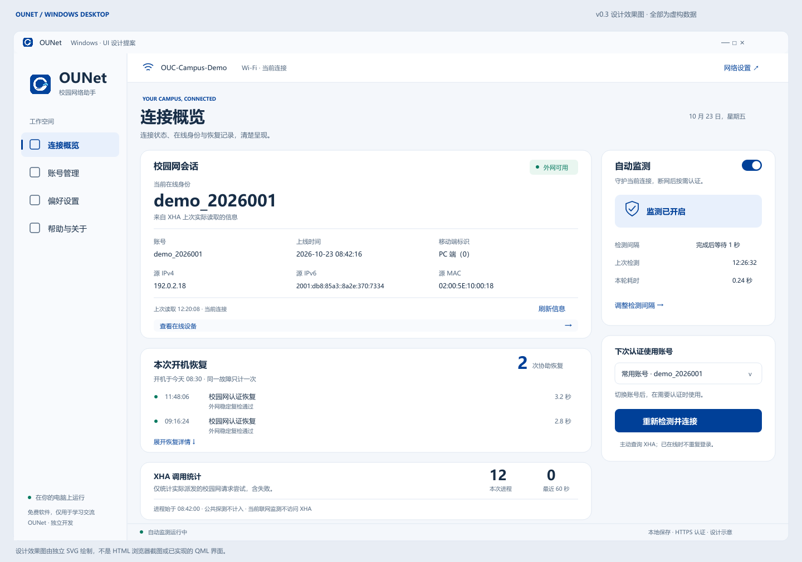

# OUNet Windows v0.3 · 设计审阅

2026-10-23 · 设计历史交付。后续已实现真实 Windows 0.3.0，见[实施验证](../../../docs/WINDOWS_V0_3_VERIFICATION.md)。本目录的 HTML 与独立 SVG 仍是设计资料，下文检查范围仅描述原型。

## 交付内容

- [完整 UI 设计与产品规划](../../../docs/WINDOWS_DESKTOP_V0_3_DESIGN_PLAN.md)：跨端功能取舍、四页交互、视觉规范、业务状态、请求保护、迁移、优先级与验收矩阵。
- [四页可点击设计稿](index.html)：使用 Edge / Chrome 打开，所有依赖在本地，无 CDN。请保留相对目录和 `../../ounet/ounet-desktop.png`。
- [连接概览效果图](previews/overview.png) / [可缩放 SVG](previews/overview.svg)：独立绘制的静态设计效果，不是 HTML 截图，也不是已实现的 QML 界面。



## 建议审阅顺序

1. 查看正常概览：当前会话六字段、右侧监测和账号、下方开机恢复与 XHA 统计。
2. 使用顶部“演示场景”切换首次联网、密码错误、连续三次失败、XHA 不可达及待恢复。
3. 切换下次认证账号，观察当前在线身份不随本地选择改变。
4. 密码错误场景点击“修改密码”；账号页可添加、编辑、选用、删除演示账号；未保存切换提供保存/放弃/取消。
5. 暂停场景开关监测或切换账号，暂停继续保持；“手动重试”模拟一个成功的试探请求。
6. 偏好设置输入 0.3 秒和非法值，查看完成后等待与校验文案；切换深浅外观。
7. 在线设备抽屉模拟分页失败；帮助页打开最新在前的诊断抽屉与离线说明。
8. 顶部选择 1200 / 1008 / 820 / 640 宽度，审阅布局规则；实际 DPI 与屏幕阅读器仍需在 QML 实现后验证。

顶部预览栏、场景、宽度选择器不属于正式产品；标题栏系统按钮为无交互示意。主界面的网络设置、自启、更新、导出均只展示说明，不修改电脑。样本使用 `demo_*`、文档 IPv4 / IPv6 和虚构 MAC。不要输入真实凭据。

## 原型能力边界

HTML 仅在本页内存中改变演示数据，不读取真实设置，不调用 XHA，不发公共探测，不切换 Wi-Fi，不写入自启或任务计划，不下载更新，不持久保存表单。刷新页面即还原。密码字段仅用于演示表单校验，输入后不存入账号模型。

请求量与恢复次数都是演示数值，主按钮使用短动画模拟处理，不代表真实网络测得的时间或请求路径。演示场景中“手动重试”只模拟成功分支；失败保持暂停的实际逻辑以后续桌面测试为准。原型没有真正执行三次 HTTP 失败或长时间后台调度。

诊断展示当前内存中的示例记录，不实现真实文件监听、历史锚点或高频自动滚动。设备分页提供失败状态示例，不表示真实协议已经完成。正式版 P0/P1 范围以规划文档为准。

## 本轮检查与限制

- 已完成 JavaScript 语法、HTML ID / 本地资源、文档链接、SVG 结构、无远程请求与无浏览器存储的静态检查，结果见 [verification.json](verification.json)。
- 静态效果图通过 Qt SVG 导出 PNG，已检查中文、数据字段、卡片布局和品牌图标；使用 Windows 字体，没有复制字体文件。
- 浏览器交互未验证：`browser-use` 环境没有可用连接；内置浏览器无法连接本地预览服务，且不允许打开 `file:` URL。本轮没有绕过该限制。
- 因此不宣称 HTML 的浏览器交互、响应式断点、真实键盘焦点、高对比或 DPI 测试已通过。
- 本轮没有提交真实认证、读取用户凭据、运行桌面程序或构建安装包，也未修改 Android / Windows 应用源码。

可重复导出效果图：

```powershell
.\desktop\.venv\Scripts\python.exe design\windows\v0.3\export_board.py
```

本目录的 `export_board.py` 只渲染独立 SVG 设计板，不能替代 HTML 或实际 QML 的视觉测试。
