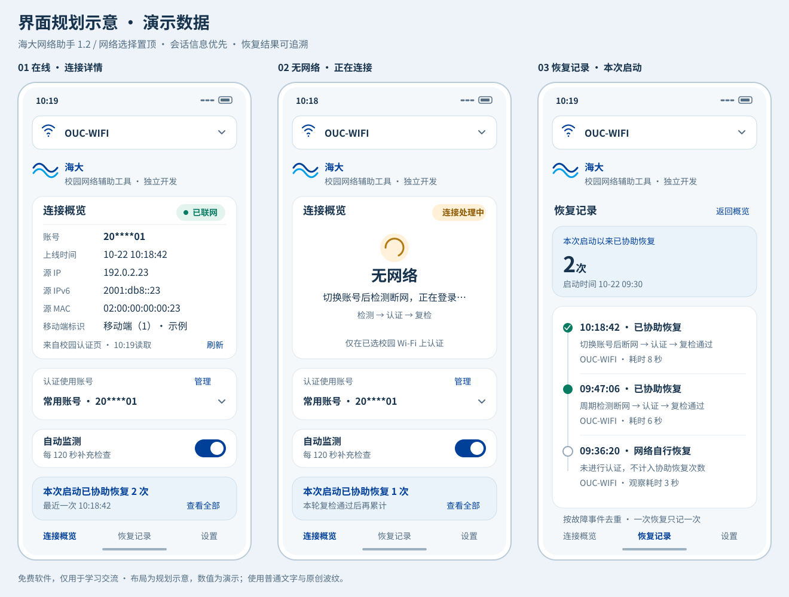

# 海大网络助手 Android 1.2：界面重构与连接体验升级规划

日期：2026-10-22（Asia/Shanghai）｜基线：Android 1.1.0｜建议版本：1.2.0 / versionCode 3

**状态：1.2历史设计基线，工作区已有开发实现。** APP内统一使用“海大”，底部固定标注“免费软件，供学习交流与使用”；不使用学校全称与官方标志。后续需求以 [1.3设计与任务规划](ANDROID_V1_3_DESIGN_PLAN.md)为准，其中已取消Wi-Fi选择。已归档检查范围见 [验证记录](ANDROID_VERIFICATION.md)。

## 1. 产品方向与本次决策

首页围绕三件事组织：**选择正在使用的 Wi-Fi → 看清学校报告的连接身份 → 知道助手本次帮助恢复了几次网络。** 将工程参数、权限说明和调试信息移到设置或诊断，保留校园辨识度，减少占用首屏的长段说明与按钮。

| 用户需求 | 本版确定的行为 |
| --- | --- |
| 账号切换后立即检测，无网登录 | 真实用户切换账号触发一次完整的“检测→按需认证→复检”；不等待周期；仍遵守现有60秒认证间隔和三轮暂停 |
| Wi-Fi 下拉置顶，切换后检查并登录 | 顶部只展示系统确认的连接名称；选择其它网络时完成系统连接交互，确认实际接入后立即检测，必要时认证 |
| 加入海大元素 | 海蓝/天蓝、简洁海大文字、原创海浪图形、固定免费说明；连接数据优先，校园装饰不占据大幅首屏 |
| 顶部展示六项在线信息 | 账号、上线时间、源IP、源IPv6、源MAC、移动端标识来自学校的当前设备会话；与本地已选账号严格区分 |
| 无网络时显示无网络 | 隐藏在线六字段，用“无网络”及当前处理动作展示；不把旧缓存包装成在线事实 |
| 删除旧文案和重复 Wi-Fi 行 | 首页删除四类指定文案；Wi-Fi 名称只在顶部选择器出现，不另列本机/当前/目标三行 |
| 逐条列出启动以来的恢复并统计 | 增加本次运行的结构化恢复台账，按故障事件去重；应用认证后复检通过才计入协助恢复，自行恢复单独记录 |

本版保留多账号加密存储、秒级间隔、后台服务、跨品牌设置指导和认证保护。暂不加入强制下线其它设备、自动轮换账号试密码、云端同步、余额缴费和校园资讯流。

## 2. 当前体验诊断与改造重点

| 1.1.0 实现 | 本版问题与改造 |
| --- | --- |
| `MainActivity` 将状态、三行网络文本、权限和操作堆在长页面 | 首页改为连接概览，配置与诊断退后；引入明确的信息层级 |
| 账号选择、目标保存、间隔保存都调用 `configurationChanged()`，最终只读检查 | 拆分操作原因，账号/Wi-Fi切换可以触发本次按需认证，间隔/备注保存保持不认证 |
| Wi-Fi 下拉位于二级弹窗，仅修改目标，不负责实际连接 | 新增顶部选择器与系统连接确认流程，不能只移动旧控件就宣称实现切网 |
| `PortalClient` 只实现登录上下文与认证，没有在线详情模型 | 新增独立的只读会话读取器、当前设备匹配、缓存与刷新状态 |
| `AppStore.status()` 和截断的 `events.log` 是自由文本 | 首页绑定结构化连接状态；恢复次数不从文本日志猜测或统计 |
| 已有 `generation`、Wi-Fi绑定请求、取消、单认证线程与频控 | 继续复用，并把会话查询与统计写回纳入旧结果失效规则 |

## 3. 视觉系统与校园元素

### 3.1 视觉规范

| 项目 | 设计值及用途 |
| --- | --- |
| 主色 | 海大海蓝 `#004098`：主按钮、选中项、小面积品牌重点 |
| 辅色 | 海大天蓝 `#00A0E9`：原创海浪及局部点缀，不用作浅底上的细小正文 |
| 界面衍生色 | 深色文字 `#17334D`，次级文字 `#536D83`，背景 `#F5F8FB`，卡片 `#FFFFFF` |
| 状态 | 已联网 `#087B63`，处理中/冷却 `#8C5900`；颜色同时配合文字和图标，不能只靠红绿区分 |
| 字体 | 系统中文无衬线；主状态24sp、页标题20sp、卡片标题18sp、正文16sp、辅助说明14sp；地址可用等宽字体 |
| 间距 | 4/8/12/16/24dp 阶梯；页面左右16dp，卡片内部16dp，卡片间12dp |
| 控件 | 顶部 Wi-Fi 选择器约56dp高，触控目标至少48dp；主卡圆角约20dp，其它卡16dp，避免重阴影 |
| 密度 | 首屏优先容纳 Wi-Fi 选择器、六字段概览、账号入口；计数紧随其后，详细时间线放二级页 |
| 适配 | 320dp窄屏、系统大字号、长IPv6与SSID都可换行；六字段不以省略号隐藏关键尾部，不压缩字号来硬塞 |

海蓝与天蓝沿用仓库已记录的校方标准色，来源见[官方标准色页](https://news.ouc.edu.cn/2021/0610/c321a105824/page.htm)及[现有素材来源说明](../design/windows/SOURCES.md)。灰阶、状态色、布局和波纹属于本产品设计，不标为学校官方规范。

### 3.2 校园元素的落点

- 顶部选择器下放小型品牌行：“海大网络助手 / 校园网络辅助工具”，搭配原创双波纹，控制在两行内。
- 底部固定标注“免费软件，供学习交流与使用”，各主导航页面均可见。
- 关于页保留“独立工具、非学校官方客户端”说明。只使用普通字体“海大”与原创波纹，不采用官方徽标或专用校名字标。
- 本版不使用校园照片；界面素材随APK离线提供。

### 3.3 界面示意



[单独打开大图](../design/android/v1.2-overview.svg)。这是布局示意，使用虚构、脱敏数据，不是手机截图；移动端标识示例“1”不代表已经取得某台手机的真实返回值。图中的在线/连接中/记录页分别展示不同状态。

## 4. 信息架构与首页布局

主导航分为“连接概览、恢复记录、设置”。诊断放在设置内，首页不保留整屏权限按钮。

```text
系统状态栏 / 安全区域
┌────────────────────────────────┐
│ Wi-Fi图标   OUC-WIFI          ▾ │ ← 全页最顶部，显示实际已连接名称
└────────────────────────────────┘
海大网络助手 · 海大       设置

连接概览                         已联网
账号             20****01
上线时间         10-22 10:18:42
源IP             192.0.2.23
源IPv6           2001:db8::23
源MAC            02:00:00:00:00:23
移动端标识       移动端（1）
来自学校认证页 · 最近读取10:19:00  刷新

认证使用账号     [ 常用账号 ▾ ]  管理
自动监测         开启 · 每120秒补查

本次启动已协助恢复 2 次          查看全部
10:18:42  认证后恢复 · 耗时8秒

[ 重新检测并连接 ]
连接概览              恢复记录        设置
```

“上线时间”是服务器会话建立时间；“最近读取”是采集时间；“本次启动”是APP运行开始时间，三者不混用。IPv6较长时独占两行，账号与地址支持用户主动查看/复制完整值，普通诊断记录保持脱敏。

### 4.1 删除与替换清单

| 旧内容 | 新版处理 |
| --- | --- |
| `校园Wi-Fi网络正常，本轮未登录`，包括带空格变体 | 从用户界面移除；用简洁“已联网”及六字段卡替代 |
| `本机网络：Wi-Fi可用` | 从首页移除；不再用默认网络状态充当校园Wi-Fi结论 |
| `当前 Wi-Fi`这一行 | 移除；实际名称只显示在顶部选择器 |
| `目标 Wi-Fi`这一行 | 移除；后台仍保留用户确认的SSID身份条件，不因隐藏文案而取消安全校验 |
| 首页长段协议、权限、计数规则 | 移到设置/诊断；首页只保留当前需要用户采取的动作 |

删除的是显示文案，不是对应的网络校验。切换目标、权限异常等内部状态仍存在，但不以三行重复配置说明占据首屏。

### 4.2 不同状态的主卡

| 状态 | 主卡显示 | 六字段与操作 |
| --- | --- | --- |
| 首次检测/切换后尚无结论 | 正在检测 | 骨架或短进度，不把旧数据当新结果 |
| Wi-Fi外网已验证，会话已取得 | 已联网 | 显示六字段、来源及读取时间 |
| Wi-Fi外网已验证，会话正在读取 | 已联网 · 正在读取会话 | 六个字段位显示加载态；网络状态先更新，不等待数据查询 |
| Wi-Fi外网正常，学校未提供会话 | 已联网 · 会话信息暂不可用 | 保留六个字段名，以“未获取/页面未提供”占位，可单独重试，不重新认证 |
| 已确认无外网 | **无网络** | 整组隐藏六字段；副行显示“正在认证/复检/等待系统连接/账号未配置”等原因 |
| 认证冷却或暂停 | **无网络** | 显示剩余等待秒数或暂停原因；保留设置/排障入口 |
| 无法确认网络身份或检测结论 | 正在检测 / 暂无法确认 | 显示精确原因，不编造“无网络”或在线会话 |

“无网络”指本次所选、实际连接的Wi-Fi无法通过外网连通性验证。移动数据可用不能改变这个结论；同样，学校会话接口失败不能推翻已经通过的外网验证。

## 5. 账号切换与按需认证

### 5.1 完整流程

1. 用户将账号A切到B，先提交选中状态，产生新的配置代数和一次性用户操作ID，取消旧轮后续请求。
2. 立即提交对已选Wi-Fi的检测，不等待10–3600秒周期。
3. **已有网络**：不登录B、不注销A，读取学校实际会话。若服务器仍显示A，顶部继续显示A；下拉框显示B，并用短提示说明“已选B，下次需要认证时使用”。
4. **没有网络**：在实际连接身份、凭据、学校认证协议和保护规则均符合时，用B执行一轮认证，再对相同Wi-Fi复检。
5. 复检通过后更新在线卡、读取六字段，并按恢复统计规则判断是否新增事件；接口仅返回“成功”不代表网络已经恢复。

顶部“账号”表示**实际在线账号**；下方“认证使用账号”表示**准备使用的本地账号**。可以不同，不通过替换文字伪装为已经换了在线会话。

### 5.2 与监测开关及保护的关系

| 条件 | 处理 |
| --- | --- |
| 自动监测关闭，用户主动切账号 | 允许本次检测与按需认证，不自动开启长期监测；本次最多一轮认证 |
| 自动监测开启 | 本次立即检查；之后仍按原有事件和周期运行 |
| 60秒认证间隔尚未到期 | 立即检测；无网时显示剩余秒数，不绕过频控。到期只重新评估一次，需配置仍有效且用户仍在前台，或后台监测已开启 |
| 三轮保护已暂停 | 立即检测，但不访问认证流程；只有外网确认恢复或用户明确重置才解除 |
| 账号密码缺失/不可解密 | 显示无网络和配置修复入口，不试其它账号 |
| 重选同一账号/界面初始化回填 | 不视为新切换，不生成额外认证 |
| 快速A→B→C | 只保留C的最新意图；旧结果、旧会话查询及旧统计写回不得覆盖C |
| 修改备注、检查间隔 | 仅保存和重排计划，不因此提交登录；密码编辑保留失败保护 |

监测关闭时，用户离开APP会取消尚未执行的冷却后认证；打开系统Wi-Fi面板属于连接交互，待其返回并核验真实连接后继续。已经交给网络栈的请求无法保证撤回，之后以学校实际会话为准。

## 6. 顶部Wi-Fi选择与真实连接

### 6.1 选择器内容

收起时只显示系统已确认的SSID；没有连接时显示“选择Wi-Fi”，权限不足时显示“名称读取受限”。展开后展示已连接项、附近名称、结果年龄、重新扫描及系统连接入口，不出现两份重复的当前/目标行。

选择其它名称后，记录待连接意图并让旧轮失效，但**不把新名称冒充为已经连接**。等待期间顶部仍显示真实名称，选择器内以辅助行提示“等待连接至××”；系统回调确认后才更新收起时的名称。

### 6.2 连接流程

```text
选择已连接网络 → 立即检测 → 无网且条件允许 → 认证 → 复检
选择其它网络 → 系统Wi-Fi连接交互 → 实际SSID/Network确认
                                      ↓
                       名称更新 → 检测 → 按需认证 → 复检
```

普通Android应用不能凭一个SSID字符串保证静默切换系统连接。建议本版使用Android 10起的系统Wi-Fi面板，Android 9及面板不可用时回退系统Wi-Fi设置；新网络的无线密码由系统处理，不与校园网账号密码混用。[系统Wi-Fi面板](https://developer.android.com/reference/android/provider/Settings.Panel#ACTION_WIFI)、[网络建议机制](https://developer.android.com/develop/connectivity/wifi/wifi-suggest)

`WifiNetworkSuggestion` 由系统决定是否采用；Android 11起添加已保存网络也需要用户完成系统交互，不能承诺选择即连。首版不为“切网”引入私有厂商接口、无障碍自动点按或模拟点击。[添加网络的官方说明](https://developer.android.com/develop/connectivity/wifi/wifi-save-network-passpoint-config)

### 6.3 结果与异常

- 用户取消系统连接：清除本次待连接意图，不在旧网络上替新目标提交账号。
- 系统连到另一个网络：顶部如实显示，要求在选择器确认本次网络；不能只凭默认网络可用就认证。
- 系统设置返回后约30秒仍未确认所选连接：显示“连接尚未完成”，提供继续设置或取消，不无限自动重试。
- 双Wi-Fi：只有可唯一绑定到实际Network的连接才能认证；同名双连接无法区分时说明原因并停止。
- 监测关闭：完成系统连接并回到APP后立即检测；监测开启且后台能力允许时可由连接回调触发。网络事件保留约2秒的连接稳定合并窗口。
- SSID是展示和匹配条件，`Network + connectionEpoch` 才是请求与缓存边界；重新接入同名网络也不能沿用旧句柄。

## 7. 学校在线信息：证据、字段与读取

### 7.1 本轮已核实与未核实的范围

本轮以无凭据HTTPS GET取得学校根页面、`a79.htm`、[a41.js](https://xha.ouc.edu.cn/a41.js)、[a43.js](https://xha.ouc.edu.cn/a43.js)，并只读核对动态 `page/loadConfig` 的列配置，未执行远程JS，未登录、注销或查询任何个人在线记录。

公开配置明确包含 `login_time,login_ip,login_ip_v6,mac_address,phone_flag`，对应“上线时间、源IP、源IPV6、源MAC、移动端标识”。账号读取方式、在线记录接口与当前设备标识也有公开脚本依据。

仓库Windows版已有[只读会话适配器](../desktop/ouc_desktop/portal_status.py)和离线测试，可复用协议认识；Android手机的实际返回、当前设备唯一匹配、字段空值和后台读取行为仍需实测，不能因Windows代码存在就记为手机已通过。

### 7.2 六字段契约

| 首页字段 | 数据来源 | 显示与校验 |
| --- | --- | --- |
| 账号 | 当前在线状态的 `uid` | 来自服务器，不用当前下拉账号替代；首页可脱敏，用户主动查看完整值 |
| 上线时间 | 当前在线记录 `login_time` | 使用服务器时间；不替换为APP启动/本轮恢复/当前手机时间；格式或时区不明时保留原文 |
| 源IP | 当前在线记录 `login_ip` | 展示门户观察到的源地址，不直接称公网IP，不用Android本地地址补齐 |
| 源IPv6 | `login_ip_v6` | 缺失或未启用时显示“页面未提供”；支持完整换行、主动复制 |
| 源MAC | `mac_address` | 展示服务器会话值；不以Android随机MAC、受限占位MAC或推测值替换 |
| 移动端标识 | `phone_flag` | 保留原始值。公开网页将0显示为PC端，其余有效分支显示移动端；缺失/非预期格式显示未提供或未识别 |

**登录请求参数 `terminal_type=2` 不等于在线记录的 `phone_flag`。** 不能因为APP运行在手机上，就自行把服务器端标填写成“移动端”。

地址字段只做数值格式校验和规范化，不以字段值触发DNS。`0.0.0.0`、`::`、全零MAC等占位不当作有效设备地址；缺字段不改写为“无网络”。异常长字段和控制字符受长度/显示限制，原始接口数据不写普通日志。

### 7.3 读取与当前设备匹配

1. 绑定顶部所表示的实际Wi-Fi Network，复用有效的门户配置上下文，动态发现HTTPS端口、方案及页面参数。
2. 根据学校配置选择在线状态读取方式。现有适配路径使用 `/drcom/chkstatus` 取得当前账号与接入上下文；公开脚本也存在 `check_online_method` 切换到 `online_list` 的分支，须按实际配置单独适配验证，不盲目硬编码。
3. 从 `/eportal/portal/page/loadOnlineRecord` 取得在线记录，仅保留当前设备信息，不展示同账号的其它设备列表。
4. 优先按服务器 `is_owner_ip=1` 筛选；没有该标识时，用同Network获得的有效源IP匹配；多个候选再用有效服务器MAC核对。IPv6-only等情况没有足够证据时显示无法确认，不改取第一条。
5. 最终唯一且未与当前接入上下文冲突，才提交六字段。零条、多条、字段结构变化或无法自证当前设备时，保留“已联网”，会话显示暂不可用。

只读会话接口精确加入HTTPS请求白名单；仍限制学校域名、证书、重定向、响应大小和JSON/JSONP结构。端口由当前脚本发现，非从本规划抄一个永久端口；页面/脚本编码须支持本轮观察到的GB2312/GB18030，不执行网页内脚本来获得字段。

### 7.4 刷新、缓存与预算

| 触发 | 行为 |
| --- | --- |
| 第一次启动且已确认Wi-Fi在线 | 自动读取一次，无需先填写本地校园网账号 |
| 第一次启动无网络 | 显示无网络，暂不抓会话；网络复通后再读取 |
| 外网由不可用变为可用 | 立即提交在线状态，再异步刷新六字段；不等待信息接口才宣告恢复 |
| 账号/Wi-Fi切换后验证在线 | 重新确认实际会话；请求结果绑定本次操作代数 |
| 普通周期检查仍在线 | 不每轮重复整套会话请求；建议相同连接的信息有效期5分钟，过期再低频刷新 |
| 用户点“刷新会话” | 只更新信息，不触发登录；同连接同代数查询合并，建议至少10秒间隔 |

新增会话查询使用独立、可取消、最多一轮的低优先级任务，建议**整套总预算8秒**，不是五个请求各8秒。可复用已取得的页面/配置，账号或网络改变时立即取消并丢弃旧结果；认证流程优先，不被信息查询阻塞。

缓存以 `Network/connectionEpoch + configGeneration + 实际在线账号 + fetchedAt` 约束。同一网络仍在线时可明确标“上次读取，正在刷新”；更换网络、发生认证或已离线时，旧六字段不得作为当前数据展示。没有可靠缓存时显示占位。

会话失败不消耗登录尝试、不清空恢复计数、不触发额外认证。三轮暂停且仍无网时不继续读取学校会话，维持原来停止学校请求的保护；Wi-Fi外网确认恢复后才进入信息读取。

## 8. 本次启动以来的恢复台账

### 8.1 统计口径

主指标文案采用 **“本次启动已协助恢复 X 次”**。一条“协助恢复”必须同时具备：

1. 本次运行已对实际连接的所选Wi-Fi观察到外网故障，并建立唯一 `outageId`。
2. 当前有效账号/连接代数中，APP确实提交了认证，且学校明确确认认证成功。
3. 随后的同一连接上下文外网复检通过，恢复状态经后续复检稳定确认。
4. 该 `outageId` 尚未生成协助恢复事件。

一段断网期间的多次失败、重复网络回调、重试和账号切换，都属于同一次故障；不能按“检查成功次数”或“登录请求次数”累加。

稳定确认采用明确的两次判定：第一次外网探测通过即可更新“已联网”；同一 `Network/connectionEpoch` 约2秒后再次通过，且期间未发生检测失败或连接丢失，才提交恢复台账。第二次未通过则保留原 `outageId`，继续观察同一故障，不提前增加次数。

| 情况 | 主计数 | 时间线分类 |
| --- | --- | --- |
| 已确认断网，APP认证成功且复检通过 | +1，最多一次 | 认证后恢复 |
| 启动时已经正常 | 不加 | 初始已联网，不伪造一次修复 |
| 服务器返回成功但外网仍不可用 | 不加 | 本轮未恢复，归入同一故障的尝试记录 |
| 未提交认证便复通 | 不加 | 网络自行/外部恢复 |
| 仅返回“已经在线”、超时后自行复通或旧轮响应 | 不加 | 恢复来源未确认，不冒称APP修复 |
| 切到另一个本来正常的Wi-Fi | 不加 | 网络切换完成，不把它记为修好原网络 |
| 同一故障内换账号后认证恢复 | +1 | 记录最终认证账号和触发动作，不另开重复故障 |
| 跨网络或连接代数已经失效 | 不加到旧故障 | 关闭旧上下文；新网络另行判断 |

“协助”是可观察的“有效认证后复检通过”口径，不据此推断学校故障的根本原因。首次启动已经断网时可以建立事件；未被本APP观察到的历史断网不补记。

### 8.2 APP启动周期

建议以**应用进程本次运行周期**为边界：在 `Application.onCreate` 建立 `launchId` 和真实开始时间，Activity旋转、返回前台、导航切页、关闭主窗口但后台服务继续运行，都不清零。

进程被系统结束、用户强制停止后重新启动，或后台服务在新进程恢复，均建立新的周期；界面显示“本次运行开始于××”，避免把系统开机时间当APP启动时间。认证失败保护独立持久化，不能随新周期一起清零。

### 8.3 记录内容与界面

- 首页显示次数和最近一条；“查看全部”进入时间线，最新在前，逐条可展开。
- 每条含发现故障时间、恢复时间、持续时长、Wi-Fi、脱敏账号、触发原因、尝试轮数和恢复类型。例如：`10-22 10:18:42｜切换账号后认证恢复｜耗时8秒`。
- 恢复时间显示日期与秒；持续时间使用单调时钟，手机校时不能产生负耗时或重复计数。
- 自行恢复使用次级样式并注明“不计入协助恢复”；不能只用绿色/灰色区别。
- 本次周期所有事件可分页查看，不能因只展示最近几条或原日志截断而丢失其余记录。

### 8.4 存储与一致性

新增独立的内置SQLite恢复台账，密码仍留在现有Keystore/配置存储，不迁入台账。建议核心字段：

```text
LaunchSession: launchId, startedAtUtc, startedElapsed, endedAtUtc
Outage:       outageId, launchId, connectionEpoch, ssid,
              detectedAtUtc, detectedElapsed, state
Recovery:     eventId, launchId, outageId, recoveredAtUtc,
              durationMs, kind, triggerReason, maskedAccount, attemptCount
协助恢复唯一约束：在 kind='ASSISTED' 的行上，对 (launchId, outageId) 建立部分唯一索引
```

恢复写入与故障关闭在同一事务完成，计数从当前周期的协助恢复事件查询得到，不维护一份容易与列表不一致的独立数字。写入失败不增加数字，联网结果照常显示，提示“恢复记录未能保存”。不从旧的截断文本日志倒推统计。

新周期显示从0开始；旧周期不混入主计数，清理策略与当前周期隔离。本版只要求本次周期完整列表，不扩展成跨月历史分析功能。台账不保存密码、完整认证URL和六字段原始响应。

## 9. 状态、任务和数据模型

避免继续用一个 `status` 字符串同时描述联网、认证和信息查询。建议拆分：

```text
ConnectionState: CHECKING / ONLINE / OFFLINE / INDETERMINATE
AuthState:       IDLE / LOGGING_IN / VERIFYING / COOLDOWN / PAUSED
SessionState:    LOADING / READY / STALE / UNAVAILABLE
TriggerReason:   APP_START / ACCOUNT_SWITCH / WIFI_SELECTION_CONFIRMED /
                 PERIODIC / MANUAL_CHECK / SESSION_REFRESH
ActionContext:   actionId, triggerReason, accountId, credentialRevision,
                 configGeneration, ssid, Network, connectionEpoch,
                 oneShotAuthAllowed, cancellation
```

主卡由以上状态组合渲染，不展示底层旧文案。手动切换可授予本次认证意图，单独“刷新会话”不能升级为认证。待执行任务只保留最新有效操作；认证前、会话写回前、恢复入账前都校验代数。

会话查询与联网检测采用同一Wi-Fi网络路径，不能用手机默认路由或另一台电脑的查询结果代替当前手机。所有账号共用的60秒节流、10分钟内三轮暂停和损坏状态保守停止规则保持。

## 10. 实施阶段与代码范围

| 阶段 | 工作内容 | 交付门槛 |
| --- | --- | --- |
| P0：数据契约核验 | 对照公开配置，采集手机上在线/离线、缺IPv6、多设备记录的脱敏样本；确认状态读取分支及端标枚举 | 六字段来源、当前设备唯一匹配和编码有测试样本，不能靠猜字段完成 |
| P1：触发逻辑与状态 | 拆分配置变更原因，账号切换和已确认Wi-Fi切换的一次性认证意图，保留保护与旧轮取消 | 监测关闭也能执行本次按需连接；保存间隔不误登录 |
| P2：在线信息 | 新会话读取、精确白名单、独立预算、缓存失效和缺字段展示 | 信息读取失败不破坏联网状态，不泄露其它设备会话 |
| P3：恢复台账 | 本次运行、故障去重、认证结果结构化、事务写入与分页 | 列表和数字一致，重复回调、重启界面不误加 |
| P4：界面重构 | 顶部选择器、主卡、校园品牌、账号区、记录页与设置页；长内容和无障碍适配 | 四类旧文案移除，在线/离线布局及操作完整 |
| P5：验证与交付 | 单元测试/Lint、模拟器、四品牌设备、真实校园网、覆盖升级、同签名1.2.0试装包 | 已测/未测区分记录，最终包与源码及校验和一致 |

| 模块 | 主要改动 |
| --- | --- |
| `MainActivity`、布局/颜色/字体/字符串资源 | 首页与导航重构；真实用户操作和回填分开；不再直接拼旧状态字符串 |
| `CheckCoordinator` / `RunGate` | 按操作原因授予一次性认证，管理冷却后的单次重评估及过期意图 |
| `LoginEngine` / `PortalClient` | 结构化认证结果、复检与恢复事件钩子；删除旧成功文案的UI依赖 |
| `WifiAccess` / `WifiScanner` / 新Wi-Fi选择控制器 | 顶部选择、系统连接交互、待连接态、实际连接确认与Network世代 |
| 新 `SessionInfoClient` / `SessionInfoRepository` | 只读查询、唯一匹配、GB系编码、缓存与低优先级刷新 |
| 新 `RecoveryRepository` / `LaunchSession` | SQLite台账、唯一约束、当前周期计数及分页 |
| `AppStore` / `RequestPolicy` / `WifiTransport` | 保持凭据与保护；精确放行新只读接口，复用TLS/网络绑定/取消 |
| `MonitorService` / `BootReceiver` | 本次进程周期与后台恢复衔接，不把重建界面当新启动 |
| 版本/构建/说明 | 实施完成后再提升版本与产物名；沿用原签名，完成检查后生成1.2.0试装APK |

1.1.0账号、密码密文、已选账号、已确认SSID、秒间隔、开关、失败保护及节流时间原样迁移；新台账首次建立为0，不回填旧日志。SQLite/信息缓存故障不能删除原账号或放行失效保护。

## 11. 验收清单

### 11.1 视觉与数据

- 顶部首个业务控件是Wi-Fi下拉；正常状态只显示一次实际名称。选择未连接候选时不提前冒充已连接，取消系统连接不误登录。
- 主卡在线时按约定显示六字段及读取时间；离线时整组隐藏，仅保留“无网络”和处理动作；四类指定旧文案不再出现在页面。
- 在线账号A、下拉选择B时不把顶部替换成B；上线时间不取手机当前时间；IP/MAC/端标不使用本地推测值补齐。
- 缺IPv6、无端标、接口失败、无法唯一匹配均有明确占位；已确认联网时不会因此变成“无网络”。
- 320dp、大字号、完整IPv6、长SSID、长备注、键盘与手势区域都无遮挡；内容可换行，字段可由屏幕阅读器正确读出。

### 11.2 连接与保护

- 断网时切B：立即开始检查并仅用B按需认证；监测关闭也适用。本次操作结束后不暗中启用长期监测。
- 已联网时切B：只检测并刷新会话，不强制注销或提交登录。
- 冷却时切B/C：立即检测，认证等待剩余时间；三轮暂停、切换账号、改SSID和进程重启均不能绕过保护。
- Wi-Fi切换经过系统确认；默认移动数据在线、VPN或同名双Wi-Fi不能掩盖校园Wi-Fi离线或导致错误通道登录。
- 快速切换、权限回收、连接丢失、旧查询晚返回时，旧六字段、旧认证结果和旧统计不能写入新上下文。

### 11.3 统计与生命周期

- 同一断网连续检测、两轮重试、多个复检成功回调，只产生一条协助恢复。
- 登录返回成功但外网未恢复、自行恢复、“已在线”提示、换到其它正常Wi-Fi均不误加主计数。
- 旋转、Activity重建、返回前台和后台监测继续运行时保留当前周期；进程重启新建周期，认证保护仍保留。
- 当前周期事件列表与计数一致，超过一页仍可逐条查看；写入失败不得先把数字加上。
- 原1.1.0覆盖升级后账号密文可读，所选项与保护状态不变；小米、iQOO、vivo、OPPO分别完成真实网络与后台验收。

## 12. 本轮交付与实施前仍需验证的事项

本轮交付本文和[三屏界面示意](../design/android/v1.2-overview.svg)。已完成源码差距审查、公开门户脚本/列配置核对、Android系统连接接口核对；没有读取个人在线记录，也没有声称已取得手机六字段的实测响应。

进入实现时首先完成P0，重点确认实际手机的状态读取模式、`is_owner_ip`匹配、`phone_flag`值、编码/时区及IPv6缺省，再按P1–P5落地。公开字段依据明确，不代表所有手机/校园网络模式已经验证。上述事项不影响本轮设计与规划交付。
