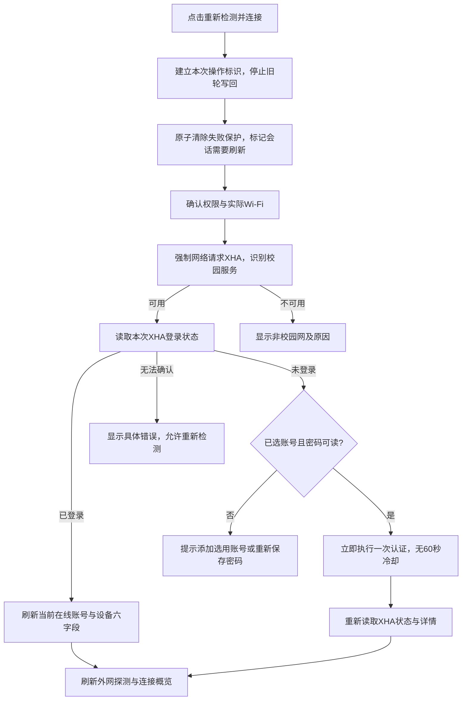

# 海大网络助手 1.3.2：认证、主动连接与诊断更新规划

日期：2026-10-23。审计基线：Android 1.3.1 / versionCode 5。

**状态：已按本规划实现1.3.2 / versionCode 6，并完成本地测试与正式构建。** 最终结果及真机待验收项见[实施验证](ANDROID_V1_3_2_FIX_VERIFICATION.md)。下文保留设计决策和验收清单。延续现有海蓝、海浪、白色圆角卡片和底部免费说明，不调整导航结构。

## 1. 结论与当前问题

固定60秒认证冷却**确实能让已经确认断网的校园Wi-Fi不立即登录**，但尚不能断言它是手机现场问题的唯一原因。失败暂停、XHA状态读取、认证配置变化、账号密码、网络权限也可能影响结果，需要新诊断记录给出实际停止原因。

当前有两套相互独立的限制，并非一个开关：

| 机制 | 当前真实行为 | 本次决定 |
| --- | --- | --- |
| 固定认证冷却 | 上次认证后60秒内不再提交；保存到`last_auth_at`，重启、换账号和手动重置失败保护都不能绕过 | **全局取消**，自动连接与手动连接均取消，不再保留隐藏60秒门槛 |
| 三轮暂停 | 认证前预占次数；第三轮开始即标记暂停；暂停形成后不会因等待10分钟自动解除 | 自动模式改为10分钟内3次**明确认证失败**后暂停；用户点击主连接按钮立即清零并重新尝试 |
| 主动连接 | 主按钮仅请求MANUAL模式，没有清除失败保护或要求重新读取在线身份 | 改为明确的一次“主动重新连接”操作，执行重置、强制XHA查询、按状态登录和刷新 |
| 校园识别缓存 | 即使要求fresh，最近10秒的成功识别仍可复用 | 主按钮必须实际请求XHA，不能只命中成功缓存 |
| 会话缓存 | 自动读取可复用5分钟；即使force=true，仍可能被10秒门槛挡住 | 主按钮的强制刷新绕过这两层缓存，并让旧响应失效 |
| 日志 | 按旧到新追加；弹窗只读取一次 | 最新置顶，展示期间更新 |
| 顶部Wi-Fi提示 | 空SSID一律显示“Wi-Fi名称不可见” | 按权限和连接原因显示，缺权限使用指定文案 |

当前“三轮”还不能称为三次登录失败：预占后，读取配置超时、配置不支持、取消请求或服务器提示已经在线，都可能消耗一轮。本次一并纠正，避免关闭冷却后快速触发不准确的暂停。

### 代码审计依据

- `LoginEngine.java:54–56`：暂停、冷却分别直接返回；`:64–68`：先占次数，再进入认证；`:81`：在线后会话查询使用非强制模式。
- `AppStore.java:137–163`：认证存储层再次检查60秒；重置只删除`retry`，保留`last_auth_at`。
- `MainActivity.java:191–192`：主按钮没有重置；`:335`：日志为一次性快照；`:206`：顶部仅判断SSID是否为空。
- `CampusDetector.java:16`：fresh成功证据仍可复用10秒。
- `SessionInfoRepository.java:32`：强制刷新也可能被10秒门槛或已进行的查询直接返回。
- `SessionInfoClient.java:70–72`：当前把“未登录”和“在线账号字段缺失”合成异常，无法供连接流程准确决策。
- `WifiAccess.java:55–61`：已有精确位置/系统定位原因，但未用于顶部的分类文案。

上述行号以本次审计的1.3.1源码为准。

## 2. 先分清三个事实

1. **校园网判定**：XHA能返回认证页面，包括可用的账号密码表单或已验证的动态表单页面，即确认校园认证服务可用。表单本身不等于当前一定未登录。
2. **XHA登录状态**：通过XHA当前会话接口判断，不能用本地所选账号、缓存字段或外网探测代替。
3. **外网连通状态**：通过轮换的公共探测判断；外网失败不能直接推导为XHA未登录。

当前已验证的`check_online_method=0`使用`/drcom/chkstatus`。本地留存的公开`a41.js`明确约定`result=0`为不在线、`result=1`为在线；其余值、格式错误、超时或未验证读取模式属于无法确认。

| XHA会话结果 | 连接行为 | 连接概览 |
| --- | --- | --- |
| 明确在线，账号可读 | 不重复提交密码，读取当前设备六字段，并检测外网 | 展示XHA实际在线身份；外网异常时标明“已登录，外网暂不可用” |
| 明确在线，但账号或详情缺失 | 不当作未登录；继续读取可确认字段或提示读取失败 | 展示已确认字段，其余显示暂不可用；不拿本地账号补齐 |
| 明确未登录 | 已选账号且密码可读时立即进入认证 | 显示正在登录；成功后重新请求XHA身份与详情 |
| 无法确认 | 显示具体阶段错误并允许重试，不把未知状态当未登录 | 显示“登录状态暂无法确认”；旧信息明确标为上次读取 |
| XHA不可达或不是认证服务页面 | 不提交凭据 | 沿用红色禁入图标与“非校园网”，附实际原因 |

“明确未登录”优先于公网成功结果：主按钮不能再因为公网探测通过，就跳过XHA登录检查。相反，XHA已在线时也不能因为公网失败而反复登录。读取详情失败不撤销已经确认的在线状态。

这些状态规则统一用于启动、切换账号、后台自动检测和主按钮；只有主按钮具有本次主动重置及强制绕过缓存的权限，其他触发来源不自动清空失败保护。

## 3. “重新检测并连接”按钮的完整流程

按钮保留当前位置和名称，处理时显示“正在重新连接…”，本次操作完成后恢复。点击即开始，不增加确认弹窗。



执行要求：

- **重置发生在网络请求之前**，即使当前没有Wi-Fi，本次明确的用户操作也应成功清除旧暂停；本地写入失败要明确报错，不假装已重置。
- 强制请求同时绕过校园识别、外网成功证据和会话详情的缓存门槛。一次流程中可复用刚取得的认证上下文，减少同一轮重复请求；不复用前一轮账号信息。
- 登录成功后主动读取XHA六字段，不能只更新本地“认证成功”文字。实际在线账号可能不同于下拉框账号，以XHA返回为准；不自动注销其他账号。
- 旧字段仅能作为带“上次读取时间”的历史信息；在线身份变化时清掉旧账号的详情和设备列表，不把不同账号的数据拼接展示。
- 一次主动操作最多提交一次登录，随后只读复检。失败后用户可再次点击，或由已开启的自动监测在下一轮处理；不在一个点击里无休止提交密码。
- 连续点击合并为同一进行中的操作，不排队提交多次，也不反复清空刚产生的失败结果。

### 并发与重置边界

增加独立的主动操作意图，例如`USER_RECONNECT`。不能把当前所有MANUAL模式都当成重置：启动、网络变化、切换账号和延迟复检也使用MANUAL，若每次都清零，自动失败保护将失效。

由协调器统一完成旧轮取消、延迟任务清理、失败记录重置和新轮准入，保持现有锁顺序。旧认证/会话/设备响应不得写回新操作；后台周期与手动操作共享一个连接执行器，XHA继续串行派发。已发给服务器的请求不能撤回，取消后应先重新查询状态再决定是否需要新的认证。

每个主动操作只重置一次；其只读复检、补充探测和异步回调不得再次触发重置。

## 4. 取消冷却与失败保护的新规则

- 删除连接层的`cooldownRemaining()`判断、对应60秒延迟重试分支，以及存储层`reserveAttempt()`中的60秒二次判断；不只删除界面文字。
- 自动模式下一次认证由已设置的检测节拍和上一轮完成情况决定，默认1秒、最低0.3秒；不增加新的固定认证等待、分钟配额或递增退避。
- 保留单轮执行、请求超时、旧轮取消和300毫秒内公共探测合并，避免重复任务；这些不作为认证冷却。
- 新失败记录只统计XHA已明确返回的认证拒绝；DNS/TLS/超时、取消、读取配置或详情失败、未知响应、已经在线均单独记录原因，不伪装成密码失败。
- XHA明确认证成功或确认在线时清除失败计数；公网异常单独处理，不重复消耗认证次数。
- 自动模式10分钟内3次明确认证失败后暂停密码提交；继续检测网络和读取状态。主按钮每次新操作立即清零并允许本次认证。设置内保留单独的重置入口，说明中删除“重置不绕过60秒”的旧文案。

### 旧数据迁移

新失败记录使用独立版本，记录实际失败结果。旧`retry.version=1`只表示预占轮次，不能直接转为新“明确失败”。升级时原子归档旧保护记录、清理旧暂停及`last_auth_at`，初始化新规则；迁移只执行一次。保存的账号密文、Keystore、选中账号、间隔、后台开关和恢复记录不变。新规则形成的暂停仍可跨重启保留，直到确认在线或用户主动重置。

## 5. 诊断记录：最新在顶部

保留现有弹窗和可选择复制的文本，标题下增加“最新在前”。文件仍按发生顺序追加；展示时按实际记录顺序反转，不能按日期字符串排序，避免跨年、同秒和设备调时打乱顺序。

弹窗打开时定位顶部；展示期间独立约1秒检查日志版本，有变化才读取和更新，不能依赖可能设为一小时的检测间隔。用户在顶部时跟随最新记录；查看历史时保持阅读位置并提示有新记录。关闭、暂停或销毁后停止刷新。

每轮记录操作来源、阶段和结果，至少能看到：

```text
09:20:04  本轮完成：XHA在线，账号信息已刷新，外网验证通过
09:20:03  XHA认证成功，正在刷新在线身份
09:20:02  XHA确认未登录，开始认证
09:20:01  XHA认证服务可用，正在读取登录状态
09:20:01  用户重新连接：失败保护已重置
```

上例为设计示例。实际日志不包含密码、完整认证URL/查询参数、原始响应或未脱敏账号。无账号、密码解密失败、权限不足、未登录、已在线、状态未知、服务器拒绝应有不同日志，不再统称为网络失败。

## 6. 顶部权限文案

顶部继续只读展示，不恢复Wi-Fi选择。通过结构化的权限/连接原因判断，不能仅靠空SSID或字符串包含关系判断。

| 条件 | 顶部文案 |
| --- | --- |
| 必需网络读取权限或精确位置未授权，或系统明确拒绝访问 | **没有网络或位置权限** |
| 权限齐全但系统定位关闭，且需要它读取名称 | 系统定位未开启 |
| Wi-Fi开关关闭 | Wi-Fi已关闭 |
| 没有连接Wi-Fi | Wi-Fi未连接 |
| 多Wi-Fi等场景无法唯一确认实际网络 | 正在确认Wi-Fi |
| 已确认连接且权限齐全，但系统仍未返回SSID | Wi-Fi名称暂不可见 |
| 可以读取SSID | 当前实际Wi-Fi名称 |

缺权限文案优先显示；若权限齐全，则已知的Wi-Fi关闭/未连接事实优先于名称读取原因。补齐系统API的权限异常处理，避免刷新界面崩溃。权限详情列出具体缺失项，沿用现有授权和系统设置入口。

不把无通知权限、未申请后台位置、普通请求超时或非校园网当成缺网络/位置权限。只缺SSID所需位置权限且仍能唯一确认实际Network时，继续允许校园识别与认证。

## 7. 按步骤实施

| 步骤 | 主要文件/模块 | 完成标准 |
| --- | --- | --- |
| 1. 拆分状态 | `SessionInfoClient`、`PortalClient`、连接状态模型 | 明确区分XHA在线、未登录、未知及详情失败，不借公网结果猜登录状态 |
| 2. 取消冷却 | `AppStore`、`RetryPolicy`、`LoginEngine` | 两层60秒门槛删除；旧记录一次迁移；失败只按真实结果计数 |
| 3. 改主动连接 | `RunGate`、`CheckCoordinator`、`CampusDetector`、`SessionInfoRepository`、`MainActivity` | 点击只重置一次，强制实际XHA请求，未登录立即认证，成功后刷新六字段 |
| 4. 改诊断 | `AppStore`日志读取、`MainActivity`诊断弹窗 | 最新置顶，新增日志可见，关闭停止更新，历史阅读不跳动 |
| 5. 改权限提示 | `WifiAccess`、`MainActivity`、`DeviceSettingsGuide` | 指定文案按原因准确显示；位置拒绝不误阻断已有Network认证 |
| 6. 验证与交付 | 回归用例、离线介绍、版本配置、说明文档 | 测试/Lint/正式构建通过；沿用原签名，输出APK、校验文件及更新元数据 |

## 8. 验收清单

1. 上次认证刚发生不足60秒时，无论手动还是自动，都不会再被固定时间门槛拒绝。
2. 存在旧三轮暂停、旧冷却或旧保护格式异常时，升级迁移及主按钮重置按新规则生效；写入失败有明确提示。
3. 点击按钮后第一项网络任务为实际Wi-Fi上的XHA请求，不能只返回缓存；无Wi-Fi时也完成本地重置。
4. 10秒内重复主动操作、5分钟内账号状态变化仍能获取新信息；连续点击不并发认证。
5. XHA明确未登录时立即提交本次选中账号；公网探测成功不短路这个判断。
6. XHA明确在线但公网失败时不重复登录，刷新可确认的身份并说明外网异常。
7. `result=1`但缺uid、详情超时或设备记录不唯一时，不误判未登录；`result=0`正确进入认证；未知值/格式/模式有明确诊断。
8. 登录成功后六字段来自新请求，旧账号详情不串入；状态查询不发送本地保存的密码。
9. 后台/账号切换/取消/网络变化与手动操作交错时，旧轮不重置或覆盖新轮结果；主动操作的复检不二次重置。
10. 自动明确失败三次暂停，网络错误不消耗密码失败次数；手动按钮解除后可立即再试。
11. 日志打开时最新在顶；同秒、跨年、调时、裁剪后顺序正确；打开后新日志可见，关闭后无刷新任务泄漏。
12. 拒绝精确位置、仅近似位置、网络读取被拒绝均显示“没有网络或位置权限”；定位关闭、Wi-Fi关闭、系统隐藏SSID与通知拒绝不混淆。
13. Android 9和Android 15布局、320dp大字号、权限返回、旋转与进程重建通过回归；真实校园Wi-Fi和小米/iQOO/vivo/OPPO按实际设备验收。
14. 原正式签名和包名保持，真实手机覆盖安装保留账号、密码与设置；GitHub附件与版本元数据一致。

本规划已实施，测试和产物以[实施验证](ANDROID_V1_3_2_FIX_VERIFICATION.md)为准。真实设备尚待验收，现场自动登录失败的具体原因仍需新版阶段日志定位。
