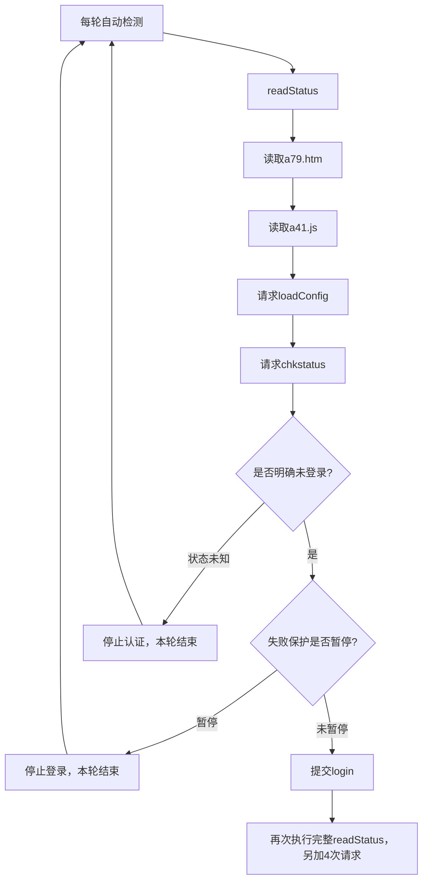

# Android 1.3.2：自动登录停止与XHA请求增长分析

日期：2026-10-23。审计基线：1.3.2 / versionCode 6。本轮分析未修改业务代码，未重新打包APK。

## 已确认的结论

用户已确认最初输入了错误的账号和密码。手机日志同时表明APP已经进入“三次明确失败后的暂停”。这是自动登录停止的直接原因；固定60秒冷却在1.3.2中已经删除。

**XHA请求持续增长来自另一处实现缺陷：失败保护只停止登录提交，暂停检查却放在完整XHA状态读取之后。** 每次自动检测仍会重新读取页面、脚本、配置和在线状态；查询失败或暂停并未停止这条重复请求链。

请求计数包括这些只读请求，不能直接当作密码提交次数。这次模拟复现了“20轮自动检测、81次XHA请求、0次登录提交”的暂停场景。

## 手机日志如何对应代码

自动监测已开启，设置间隔为1秒。用户提供的记录包含：

```text
10-23 10:48:02  XHA确认未登录
10-23 10:48:02  认证已暂停：3次明确失败；点击重新检测并连接可重置
10-23 10:48:10  XHA认证服务可用，正在读取登录状态
10-23 10:48:11  XHA确认未登录
10-23 10:48:11  认证已暂停：3次明确失败；点击重新检测并连接可重置
10-23 10:48:23  XHA认证服务可用，正在读取登录状态
10-23 10:48:23  XHA确认未登录
10-23 10:48:23  认证已暂停：3次明确失败；点击重新检测并连接可重置
```

这说明自动检测在继续运行，但每轮到失败保护分支就返回，没有再次提交登录。保护状态持久化保存，不会在10分钟过去后自动解除。修改或保存账号密码、切换账号本身也不会清除这个状态。

11:01的记录显示后来XHA已在线，外网验证通过；这些行本身没有“开始认证/认证成功”的证据，不能据此断言由APP完成了登录。

当前版本的操作方法：更正并选用正确账号后，点击一次“重新检测并连接”。该按钮会清除失败保护、强制请求XHA，并在确认未登录后使用当前账号认证。仅修改密码不足以恢复已经暂停的认证。

## 请求被放大的具体调用链



### 1. 每次状态检查实际带出四次请求

`SessionInfoClient.java:34–37`的`readStatus()`总是先调用`PortalClient.discover()`。后者在`PortalClient.java:118–135`依次请求：

1. `/a79.htm`：认证页面和客户端地址上下文。
2. `/a41.js`：认证脚本。
3. `:端口/eportal/portal/page/loadConfig`：认证配置。
4. 然后才请求`/drcom/chkstatus`：当前在线状态。

根页识别虽有缓存，但并没有缓存这条完整发现链。5分钟详情缓存也只覆盖设备六字段，不覆盖这四次请求。稳定态公共探测的15秒缓存同样不能阻止它们。

### 2. 暂停判断发生得太晚

`LoginEngine.java:41`先完整读取状态，直到`:51`才判断`store.retry().blocked`。因此暂停只省掉`/login`，没有省掉前面的四次查询。`MonitorService.java:66–68`继续按检测计划调用同一流程。

1秒是调度输入，实际请求耗时也影响轮次频率；用户日志中的轮次间隔并非恒定1秒。若响应很快，每60轮仅状态检查就约240次XHA请求；这只是调用链估算，不是对手机实际每分钟请求量的测量。

### 3. 登录后复检也重新下载整条配置链

`LoginEngine.java:72`认证之后再次调用`readStatus()`。即使本轮已经取得页面、脚本和配置，复检也会重新获取。

一次明确拒绝的认证轮次通常是：前置4次 + 登录1次 + 复检4次 = 9次XHA请求；首次校园根页识别再加1次。明确密码错误后仍做完整复检，增加了不必要请求。

### 4. 错误分支缺少整体调度约束

- 状态异常：停止登录，下一轮再重复完整发现链。
- 详情异常：`present()`没有可用完整缓存，下一轮又发详情请求。
- 认证超时、未知结果等不计入“明确拒绝”，却也没有独立的故障请求策略，可能继续重复认证和复检。
- 三个公共服务的轮换只分担公共连通性探测，不能分担XHA页面、配置和状态查询；当前暂停分支甚至在进入公共探测之前就返回。

这些是代码中存在的其他放大路径。用户本次现场已确认是错误凭据触发暂停，不应把上述可能路径都当成此次手机故障原因。

## 独立模拟复现

用生产`LoginEngine`和协调器，配合Robolectric模拟Network，每个场景驱动20轮AUTOMATIC检测、相邻轮次模拟时间前进1秒。没有访问真实XHA，也没有使用真实校园凭据。5个场景全部复现通过：

| 场景 | XHA总请求 | 登录提交 | 额外说明 |
| --- | ---: | ---: | --- |
| 一开始已有失败暂停 | 81 | 0 | 1次根页 + 20×4次完整状态查询 |
| 从未暂停开始，服务器连续明确拒绝 | 96 | 3 | 前3轮每轮9次；后17轮每轮仍4次；加1次根页 |
| 状态返回未知 | 81 | 0 | 每轮完整查询，但不进入登录 |
| 报告在线，外网失败且详情503 | 101 | 0 | 每轮4次状态查询 + 1次详情请求；加根页 |
| 认证响应未知，始终未登录 | 181 | 20 | 每轮前置4次、登录1次、复检4次；不触发明确失败暂停 |

原始汇总保存在本机被忽略的`.toolchain/request-audit-result.json`，诊断夹具及独立Gradle初始化脚本也位于`.toolchain/`，不加入正式APK和默认回归套件。本次没有改变已交付APK，其SHA-256仍为`e293c528f506888f10c1ee16ebb744fabfe793fb1182f5280ce81281fe104b9e`。

统计字段本身按所有XHA派发尝试计数，失败请求也包含在内；它不表示学校实际收到的次数。当前界面缺少“状态查询/配置/详情/登录提交”分类，使用户无法从总数判断究竟在做什么。

此前回归验证了“暂停时不再提交登录”，没有覆盖暂停后的完整XHA请求总量；公共探测频率测试也没有覆盖其前置的XHA发现链。这是此前验证的缺口。

## 建议修正顺序

1. **暂停后停止完整XHA轮询。** 本地仍更新界面并观察网络变化；手动重新连接、实际凭据变更、网络重建或有复通迹象时，按事件执行必要的单次校验。无需恢复固定60秒认证冷却。
2. **分离静态发现、轻量状态查询和详情读取。** 稳定的脚本与配置按连接/方案复用；IP、MAC等动态上下文在实际认证及网络变化时重新获取。状态查询不再每次下载配置链。
3. **明确错误凭据后立即结束该认证流程。** 显示脱敏的具体拒绝原因；不要再完整下载四项配置来确认同一失败。临时服务器异常与账号密码错误应分别处理。
4. **失败状态关联实际账号及凭据版本。** 用户真正更正账号密码后允许新尝试；改备注、重复渲染或周期复检不自动清零。避免旧错误账号的暂停阻塞已更正的凭据。
5. **给未知状态/网络故障单独制定重试规则。** 一轮只保留一个任务；共享复检结果，避免公共探测失败又重启整条XHA发现链。
6. **完善诊断与统计。** 分类显示登录、状态、配置、详情及失败尝试；暂停时保留最后一次拒绝原因。当前各阶段日志循环追加，会使最初的错误原因逐渐被重复日志淹没并可能被滚动裁剪。

本次结论：错误凭据解释了登录停止；暂停后仍重复执行完整查询解释了大量XHA计数。前者需要更正凭据并解除暂停，后者需要修正APP请求调度。
