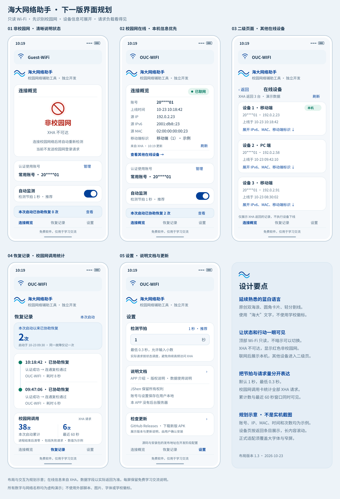

# 海大网络助手 1.3：自动识别校园网、轻量监测与更新设计

日期：2026-10-23（Asia/Shanghai）  
设计基线：工作区当前1.2开发代码与蓝白卡片风格；建议下一版为 **1.3.0 / versionCode 4**。

**设计基线现已实施为1.3.0本地试装包，自动验证与未验收项见 [实施交付记录](ANDROID_V1_3_IMPLEMENTATION.md)；尚未完成真实设备验收或远程发布。** 本文取代1.2规划中“选择目标Wi-Fi、扫描和切网”的要求；保留多账号、本机密码加密、恢复记录、原创海浪与免费说明。

## 1. 产品决策

首页只回答：**现在连着哪个Wi-Fi？它能访问校园认证服务吗？是否已经联网、使用什么在线身份？** 用户不再维护目标网络配置。

| 最新需求 | 确定的设计 |
| --- | --- |
| 删除Wi-Fi选择 | 顶部改为只读名称条，无箭头、无点击动作、无附近列表、无SSID输入和连接按钮 |
| 先判断校园网 | 启动第一项联网任务是经实际Wi-Fi验证XHA；通过后才判断外网及按需认证 |
| XHA不可达即非校园网 | 主卡显示原创红色禁入图标与“非校园网”；辅助文字说明XHA不可达原因；不提交凭据 |
| 校园网无外网立即登录 | 已有选中账号时立即进入本次认证，不等周期、不要求开启后台监测；保留60秒节流与失败保护 |
| 在线身份与其他设备 | 主卡显示学校返回的六字段；增加“查看其他在线设备”链接，进入原生二级页面 |
| 1秒推荐、最小0.3秒 | 设置支持0.3–3600秒，默认1秒；这是本地状态评估节拍，远端HTTP受独立预算控制 |
| 降低单服务压力 | 事件驱动、稳定态低频心跳、探测运营方轮换、缓存、单次请求及退避共同控制请求量 |
| XHA调用统计 | 恢复记录底部显示本次进程总请求尝试及最近60秒滑动窗口数量 |
| 设置说明 | 离线文档：APP介绍、数据使用、版权与第三方声明；增加版本与检查更新入口 |
| 免费与名称 | 仅用“海大”，不使用学校全称、徽标、专用字标；底部固定“免费软件，供学习交流与使用” |

**重要边界：** 按用户指定，以当前Wi-Fi能否访问XHA作为本APP的校园服务判定口径。这不能证明网络的地理归属；某个校外网络若也能访问XHA，可能通过此判据。学校服务故障、DNS、TLS和超时也可能导致“非校园网”。主文案遵守用户要求，具体原因可查看，不将这个结果描述成网络归属证明。

## 2. 视觉与信息架构

### 2.1 延续的风格

- 主蓝 `#004098`、海浪点缀 `#00A0E9`、背景 `#F5F8FB`、白色圆角卡片；普通文字“海大网络助手”和原创双海浪。
- 正文 `#17334D`，辅助文字 `#536D83`；在线绿 `#087B63`，处理中棕 `#8C5900`；非校园网采用深红 `#B42318`，浅红背景 `#FFF1F0`。
- 正文16sp、辅助14sp、主状态24sp；左右16dp、卡片内16dp、卡片间12dp，触控目标至少48dp。
- 红色图标用矢量画圆圈和左上至右下斜线，保证跨品牌一致；不依赖系统彩色Emoji。图标同时有“非校园网”文字与无障碍描述。
- 顶部名称和底部导航/免费说明固定，中间内容滚动。长SSID、IPv6和大字号可换行，内容不压小、不遮挡。

### 2.2 页面结构

```text
主导航
├─ 连接概览
│  └─ 其他在线设备（二级页，返回概览）
├─ 恢复记录
│  ├─ 本次运行恢复时间线
│  └─ 校园网调用专栏（页面底部）
└─ 设置
   ├─ 状态评估间隔 / 后台监测 / 账号管理
   ├─ 权限与品牌后台设置 / 诊断
   ├─ 使用文档：介绍 / 数据使用 / 版权与第三方声明
   └─ 当前版本 / 检查更新
```



[打开界面大图](../design/android/v1.3-overview.svg)。图中账号、地址、设备与统计值均为虚构演示；不是手机运行截图。

### 2.3 连接概览布局

```text
[ Wi-Fi图标  OUC-WIFI ]                  ← 只读，无下拉箭头
原创海浪  海大网络助手
          校园网络辅助工具 · 独立开发

连接概览                       校园网 · 已联网
账号 / 上线时间 / 源IP / 源IPv6 / 源MAC / 移动端标识
来自XHA · 最近读取时间                         刷新
查看其他在线设备 →

认证使用账号                       [ 常用账号 ▾ ]
自动监测                            每1秒评估状态
本次启动已协助恢复 X 次                       查看全部
[重新检测]

连接概览                恢复记录                 设置
免费软件，供学习交流与使用
```

账号选择仍保留下拉；移除的是Wi-Fi选择。上方“账号”是XHA报告的实际在线身份，下拉项是准备认证的本地账号，二者不混用。

## 3. 当前网络与校园网识别

### 3.1 选择实际网络，不再保存目标SSID

本版继续服务校园Wi-Fi：所有校园识别、探测、认证与设备查询，使用**同一个已确认的实际Wi-Fi Network**。没有Wi-Fi时不借移动数据提交校园认证。

1. 默认网络本身是可用的非VPN Wi-Fi时，采用该Network。
2. 默认路由是移动数据，但系统仅有一条可明确确认的实际Wi-Fi时，对这条Wi-Fi进行检测，避免未认证Wi-Fi被移动数据掩盖。
3. 多Wi-Fi或VPN场景无法通过公开接口唯一确认实际Wi-Fi时，显示“正在确认当前连接”，暂停认证，不任取列表第一条，也不重新引入选择控件。
4. SSID权限受限时，顶部显示“Wi-Fi名称不可见”；如果Network已唯一确认，仍可检测。SSID不再是认证前置条件。
5. 无Wi-Fi时顶部显示“Wi-Fi未连接”，概览显示“非校园网”，辅助说明“尚未连接Wi-Fi”。

Network断开或重建时，分类、探测、认证、会话和设备缓存全部失效；重新接入同名SSID也重新判断。Android官方说明Network身份会随重新连接变化，且请求可以明确绑定指定Network。[网络状态](https://developer.android.com/develop/connectivity/network-ops/reading-network-state)、[绑定请求](https://developer.android.com/reference/android/net/Network#openConnection(java.net.URL))

### 3.2 XHA验证契约

“可访问”不是DNS解析成功、TCP端口可连、任意HTTP 200或手机能打开其它网站，而是：

- 在当前Wi-Fi上访问 `https://xha.ouc.edu.cn/`，TLS和主机名校验通过。
- 在总时限内取得可识别的XHA门户页面；校验已核对的页面/脚本特征，防止通用错误页被当作校园服务。
- 若真实门户需要跳转，只允许经样本确认的同域HTTPS固定路径，最多两跳；每一跳单独统计。外域、HTTP降级与未核实跳转不跟随。
- 根页面可访问、后续在线详情接口失败时，保留校园网判定；会话数据失败不等于XHA根服务不可达。

初始建议：校园验证单轮总时限4秒；对根页面的验证成功缓存60秒。第一次进程启动、实际Network变化必须新验证；再次回到前台时，5秒内的同连接成功结果可合并复用。准备提交认证前，校园证据不得超过10秒，否则先刷新验证。以上值作为实现初值，依据真机时延校正。

XHA验证失败后立即按要求显示“非校园网”，只做低频只读复查：约15秒、30秒、60秒退避，随后最多每60秒一次；Network变化立即重判。手动“重新检测”也与同连接请求合并，不能连点绕过预算。

### 3.3 启动与恢复流程

```text
打开APP / 实际网络变化
  → 确认实际Wi-Fi Network
  → 验证XHA
      ├─ 不可达：🚫 非校园网；停止认证；低频等待重判
      └─ 可达：校园网
          → 判断外网连通性
              ├─ 已连通：展示在线身份，异步读取会话
              ├─ 未连通且有凭据：立即按需认证 → 复检
              └─ 暂无结论：补充独立探测证据，不盲目反复登录
```

“立即”表示确认条件后立即提交，不等下一个周期；并不承诺0.3秒完成TLS、门户识别或登录。启动本次检测/连接与后台监测开关分开：后台关闭仍执行本次流程，结束后保持关闭。

若系统明确报告Captive Portal，可作为外网未通的辅助证据；没有充分证据时，换不同运营方做一次补证。HTTP普通200和错误正文不算连通。系统 `VALIDATED` 是重要信号，不能被默认移动数据的标记替代。[Android能力说明](https://developer.android.com/develop/connectivity/network-ops/reading-network-state)

外网判定规则固定为：任意合格探测源返回精确成功契约即可确认连通；明确Captive Portal，或同连接10秒内两个独立运营方均探测失败且XHA证据仍有效时，按“外网未通过验证”处理并允许一轮按需认证。两个源都超时也属于这类失败，但只是本APP的判断，不能声称已经证明全部互联网不可达。只有一次失败、第二个请求被预算阻止，或连接在途中变化时，保持“正在确认网络”并等待有效证据；不把未派发的请求算成失败。

### 3.4 主卡状态与文案

| 状态 | 主卡文案 | 行为 |
| --- | --- | --- |
| 首次识别中 | 正在识别校园网 | 显示轻量进度，不展示旧身份 |
| XHA不可达/未连接Wi-Fi | **红色禁入图标 + 非校园网** | 隐藏六字段与设备入口；不提交密码；辅助原因可展开 |
| 校园网、正在确认外网 | 校园网 · 正在检测 | 不重新显示旧“无网络”标题 |
| 校园网、外网未通 | 校园网 · 待连接 / 正在认证 / 正在复检 | 凭据齐全且允许时立即认证 |
| 校园网、缺少凭据 | 校园网 · 请添加账号 | 提供账号配置入口 |
| 校园网、认证被保护限制 | 校园网 · 等待认证 / 认证已暂停 | 显示等待秒数或保护原因 |
| 校园网、外网正常 | 校园网 · 已联网 | 显示六字段及其他设备入口 |
| 在线但会话查询失败 | 校园网 · 已联网 | 六字段显示占位与重试；不重新登录 |
| 实际网络无法唯一确认 | 正在确认当前连接 | 暂停凭据请求，不凭SSID名称推断归属 |

取消首页旧“无网络”主标题；异常归因清楚区分“非校园网”和“校园网尚未连通”。

## 4. 账号、认证保护与恢复统计

- 账号切换先取消旧轮，立即复核当前网络；已联网时不注销原会话、不强制登录新账号。离线且校园判定有效时使用新账号。
- 所有账号共用至少60秒的认证间隔、10分钟内三轮暂停，0.3秒节拍不改变这两项限制。
- 三轮保护暂停时，不进行循环登录及学校详情轮询；本地网络事件和低频外网检测继续。确认网络已恢复或用户明确重置后解除；认证前的校园证据仍须有效。
- 一次故障内重复检查、重试及换账号不增加恢复次数。APP明确认证成功、相同Network稳定复检通过，才记一次“协助恢复”；自行恢复单列。
- “非校园网→校园网”本身不算修复；没有先观察到校园网外网故障，不能计入恢复。
- 首次复检通过即可显示已联网；最早约2秒后同连接再次通过且期间没有失败/断开，才提交恢复记录。补充探测也遵守服务预算；没有可用独立探测源时等待下一预算时刻，期间不提前入账，不绕过单源15秒间隔。

## 5. 其他在线设备二级页

### 5.1 交互

入口固定为 **“查看其他在线设备 →”**。进入后标题“在线设备”，副标题标明“XHA当前在线账号：××”；主内容展示该账号在XHA可见的全部在线设备，当前设备置顶并标“本机”，其他设备按上线时间排序。

每张设备卡默认显示设备类型、源IP、上线时间；展开显示源IPv6、源MAC、移动端原始标识，以及XHA实际提供的其它已支持字段。字段缺失显示“页面未提供”，不推测设备型号。首次展示只有本机时，显示“暂无其他在线设备”，同时保留本机卡。

页面有读取时间、刷新和分页。只有进入页面或主动刷新才取设备详情，后台不以1秒节拍刷新设备列表。离线、账号或Network改变后，旧列表不能继续作为当前事实；如保留历史快照，须明确标为过期。

### 5.2 数据契约

- 以学校状态接口返回的**真实在线账号**为查询上下文，不从输入框任意指定别人的账号，不跨本地保存账号循环查询。
- 复用当前会话与已验证门户配置，经XHA在线记录接口读取当前账号可见记录。
- 2026-10-22缓存的公开 `a43.js` 已显示 `loadOnlineRecord`、`start_rn/end_rn` 和分页逻辑；当前Android只读取最多100条并筛出本机，不能直接把现有结果叫作“全部设备”。[公开脚本依据](https://xha.ouc.edu.cn/a43.js)
- 实施前核实真实响应的总数、分页边界、会话唯一键与状态读取模式。每页建议20条，逐页加载直到完成；没有可靠总数时以明确的结束条件判断，不在第100条静默截断。
- 分页失败显示“已加载N条，尚未全部读取”，保留重试，不伪装成完整列表；并发变化可能造成分页结果变化，刷新时重新建立快照并去重。
- 本版只读，不加入强制下线、绑定/解绑和修改其他设备状态的按钮。

## 6. 短间隔监测与服务器预算

### 6.1 用户设置

设置项命名为 **“状态评估间隔（秒）”**，默认`1`并标“推荐”，最小`0.3`，最大`3600`；预设`0.3 / 1 / 3 / 10`。允许最多三位小数，以整数毫秒保存为`interval_ms`，避免浮点累计误差。

帮助文案直接写：**“每1秒评估本机状态；网络请求会轮换、合并并限流，实际请求频率可能更低。”** 选择0.3秒时同样显示实际请求节奏，不能将UI刷新速度包装成服务器查询速度。

这是为同时满足“很短的间隔”和“低压力”作出的明确产品取舍：0.3秒不是承诺每秒向公共服务器发送3.33次请求。若将来要求每个节拍都有真实远端探测，需要另行确认获许可的探测服务与容量。

### 6.2 三层调度

| 层级 | 任务 | 初始策略 |
| --- | --- | --- |
| 本地评估 | 消费Android网络回调、检查任务有效性、更新倒计时与界面 | 0.3–3600秒；网络回调即时处理，不等节拍 |
| 外网探测 | 判断当前Wi-Fi是否具有外网 | 稳定在线约15秒心跳；网络变化/疑似失败时优先补证；运营方轮换 |
| XHA业务 | 校园判定、认证、会话与设备查询 | 独立缓存、合并及预算，绝不作为高频外网心跳 |

稳定状态复用同连接最近证据，不每个节拍做HTTP；发现可疑失败后用不同运营方补证，避免一家服务故障导致反复登录。一个请求成功验证外网后就停止本轮，不向所有服务器群发。

### 6.3 初始预算与退避

以下是本产品建议的保守初值，**不是第三方服务公布的配额或容量承诺**：

| 范围 | 初值 |
| --- | --- |
| 外网主动探测总量 | 每个进程最多20次/滚动60秒；稳定在线通常约4次/分钟 |
| 独立探测运营方 | 最多4次/滚动60秒，连续调用至少间隔15秒；同一家不同域名共享预算 |
| 探测并发 | 最多1个请求；请求未完成时合并后续tick，不堆积队列 |
| 一次补证 | 最多另选一个独立运营方；补证和重试同样计入预算 |
| 单端异常 | 按约30/60/120秒退避；出现429遵守更长的Retry-After |
| XHA总量 | 初始上限60次/滚动60秒，包含所有页面、脚本、API、登录和设备分页 |
| XHA并发及优先级 | 单一调度入口；认证优先，设备分页最低；认证所需短突发仍逐项计量 |
| 会话与设备信息 | 同连接会话缓存约5分钟；设备页缓存约30秒，手动刷新至少10秒并合并同一请求 |

当探测池只有少量可用运营方时，单源预算优先，实际总频率进一步降低；不为凑足20次而重复打同一家。预算用尽显示下次可请求时间，不绕过限流、不追加补偿队列。普通详情查询不得耗尽认证需要的XHA预算；认证准备阶段先估算本轮保留额度，不能为详情刷新打断登录。

启动、账号切换、手动重检与后台任务共用XHA总预算；“立即”不授予绕过预算的特权。预算不足时立即展示等待原因，只保留一个仍有效的待执行意图。

认证失败保护暂停期间，XHA重复识别也退避；只有新的用户操作、实际网络变化或已观察到外网复通时才重新申请必要验证，不按0.3秒重试。

### 6.4 探测源选择

首批候选复用当前代码的Microsoft和Apple连通性端点，再评估Mozilla探测端点；每条都需固定URL、预期状态码、精确响应契约、内容大小上限与健康状态。发布前核实可用性和适用条件，不把普通网站首页当探测API。

官方资料确认这些厂商存在连通性检测机制，但不构成对本APP高频调用的授权或服务保证：[Microsoft NCSI](https://learn.microsoft.com/en-us/troubleshoot/windows-server/networking/troubleshoot-ncsi-guidance)、[Apple网络服务](https://support.apple.com/en-ie/101555)、[Mozilla探测说明](https://support.mozilla.org/en-US/kb/captive-portal)。Mozilla近期文档中的域名存在变化，具体端点在实施时核验，不照抄旧地址。

HTTP探测仅用于低敏感连通性判断，严格验证响应，不携带校园账号、密码、MAC、记录、Cookie或门户Referer；校园身份与认证始终采用XHA HTTPS。后台锁屏遵守系统调度，不持续持有唤醒锁，也不承诺0.3秒准点；前台和后台实际节奏在设置中可查看。[Android省电约束](https://developer.android.com/training/monitoring-device-state/doze-standby)

## 7. 恢复记录底部：校园网调用专栏

```text
校园网调用（XHA）
本次启动请求尝试       38 次
最近60秒               6 次
本次运行开始于 10-23 08:00:00
含页面、配置、认证和设备查询；失败尝试也统计。
```

专栏放在恢复记录的独立底部卡片，分页加载更多记录时仍在列表之后。没有恢复事件也显示统计，不把“修复次数”和“请求次数”混为一谈。

### 7.1 统计边界

| 项目 | 是否计入 |
| --- | --- |
| XHA根页、a79、a41、配置、在线状态、认证、会话、设备分页 | 每次实际派发各+1 |
| XHA动态端口、经过允许的同域重定向、显式重试 | 每个HTTP派发各+1，不因端口不同另开计数器 |
| 已派发但超时、DNS/TLS/连接失败、HTTP错误 | +1，口径是APP发起的请求尝试，不是校方实际收到数量 |
| 缓存命中、任务合并、预算拒绝、派发前取消、策略拒绝 | 不加 |
| 第三方外网探测、GitHub更新、系统自身网络请求 | 不加 |
| 用户在外部浏览器直接访问XHA | 不加；本APP无法统计其他应用的网络请求 |

在统一传输层通过策略与预算后、即将启动网络I/O处原子计数，不在每个业务调用处重复计数。统计的是应用层HTTP派发尝试：关闭自动重定向，不允许未计量的应用层重试；经过受控调度的后续HTTP请求重新计量。当前传输库可能有底层重连行为，不能宣称它与服务器实际收到的请求数逐一相同；DNS报文、TCP重传及底层连接恢复不另作业务次数。

### 7.2 时间与生命周期

- `Application.onCreate` 建立本次运行ID；总数与时间戳队列只放内存，不恢复旧值。
- 最近一分钟是滑动窗口：`now - startedElapsed < 60000ms`，60秒整的旧条目移出；不是每到自然分钟归零。
- 旋转、切页、返回前台、后台服务仍运行不清零；进程被结束后重建清零。划掉任务卡不一定结束进程，不能把它当作必然清零动作。
- 使用单调时钟计算窗口，手机校时不影响计数；多线程及所有共享客户端使用同一计量器。
- 计数不保存URL查询参数、凭据或原始响应；认证失败保护独立持久化，不能跟随清零。

## 8. 设置里的离线说明文档

文档随APK打包，无网络也可打开；在“设置→使用文档”展示三项。

**APP介绍（建议正文）**

> 海大网络助手是一个独立开发的免费校园网络辅助工具，提供校园认证服务识别、按需登录、连接信息与恢复记录。软件非学校官方客户端，供学习交流与使用。连接效果受校园服务、手机系统与网络状态影响。

**版权与第三方声明（建议正文）**

> Copyright © 2026 JShen. MIT License.  
> 项目自有代码采用 MIT 许可证。本软件免费，供学习交流与使用。第三方组件及资料的权利归各自权利人所有，具体许可见随附声明与仓库LICENSE。

发布前核对仓库现有许可与第三方义务；本轮不擅自替换仓库LICENSE。源码公开可见与授予开源许可是不同事项，不仅凭“免费”推定允许任意复制、修改和再分发。[GitHub许可说明](https://docs.github.com/en/repositories/managing-your-repositorys-settings-and-features/customizing-your-repository/licensing-a-repository)

**数据使用说明（建议正文）**

> 本APP没有自建后台服务器，不包含账号云同步、广告或使用行为遥测。账号配置、密码密文、恢复记录和设置保存在用户本机；密码通过Android Keystore加密保护。XHA调用计数仅保存在本次进程内存中。
>
> 为完成校园认证，APP会通过HTTPS向XHA发送必要的账号、密码及接入参数；在线设备信息由XHA返回。网络探测服务和GitHub更新服务会收到相应请求及来源IP。第三方探测、更新请求不携带校园账号、密码或本地记录。
>
> 清除应用数据或卸载会删除本机配置；覆盖升级按迁移规则保留配置。权限仅按具体功能申请；读取Wi-Fi名称所需权限不用于采集GPS坐标。

不能写成“任何数据都不会离开手机”；本地保存与必要网络传输需同时说明。在线设备默认仅保留当前连接的内存快照，普通日志不记录全量设备原始数据。

## 9. GitHub发布后，已安装APP如何更新

**源代码上传GitHub不会自动更新手机上的APK。** 需要发布带正式签名的新版安装包，再由手机覆盖安装。

### 9.1 现有用户立即可用的方式

开发完成后，在 [当前仓库Releases](https://github.com/JieShenAI/OUNet/releases) 发布Android正式APK、SHA-256、更新说明与版本信息。用户下载APK、点击安装、确认覆盖；无需先卸载。

保持包名 `cn.jieshen.oucautologin` 和原正式签名，递增`versionCode`。本项目下一版建议4；debug包另有`.debug`包名，不能作为正式覆盖包。账号密文、设置和数据库必须有覆盖升级迁移验证，不能承诺未测试的迁移已完成。[Android覆盖更新规则](https://developer.android.com/google/play/app-updates)、[签名管理](https://developer.android.com/studio/publish/app-signing)

### 9.2 1.3建议纳入：检查版本，浏览器下载

设置显示当前版本和“检查更新”。查询固定仓库的Android发布元数据，展示新版本、变更与“前往下载”；用户点击后打开经过校验的正式Release链接，通过浏览器下载，再由系统确认安装。此阶段不为本APP申请安装APK权限。

更新检查由用户主动发起，可选每天一次；与0.3–1秒网络循环完全分开，不随每次复通请求GitHub。缓存结果并处理API限流，失败只显示暂不可用，不影响校园认证。

当前仓库同时放置Android、Windows等工具，**不能把整个仓库的`releases/latest`无条件当成Android最新版**。建议使用`android-v1.3.0`标签和独立`android-update.json`元数据；实施时采用固定Android更新索引或按标签与包名筛选的Release源，发现非Android发布立即排除。[GitHub Release API](https://docs.github.com/en/rest/releases/releases)

元数据至少包含：`applicationId、versionCode、versionName、minSdk、releaseUrl、apkUrl、sha256、signingCertSha256、releaseNotes`。比较数值versionCode，不能按字符串比较`1.10`与`1.9`。固定仓库、Android标签和HTTPS来源，不内置GitHub Token。

### 9.3 后续增强：应用内下载与系统安装

可在后续版本加入下载进度、完整性校验和唤起系统安装器；下载后校验包名、递增版本、SHA-256及原签名证书，哈希不能代替发布者身份校验。用户点击安装时才请求安装来源授权，使用限定APK目录的FileProvider或PackageInstaller；不共享账号目录，不承诺静默安装。[安装权限](https://developer.android.com/reference/android/content/pm/PackageManager#canRequestPackageInstalls())、[安全共享文件](https://developer.android.com/training/secure-file-sharing/setup-sharing)

下载失败、用户取消、GitHub不可达或安装权限被拒绝，均保留当前版本与数据。升级启动后重新建立本次运行计数，失败保护保留；后台监测能否恢复由系统决定，必要时提示用户重新开启。

### 9.4 发布交付清单

- `android-v1.3.0`正式Release，附APK、`.sha256`、Android专用更新元数据、变更说明及对应源代码提交。
- 签名密钥与口令私下备份，永不提交仓库；CI如接管签名应复用原密钥，不能临时生成一个新密钥冒充覆盖升级。
- GitHub Actions构建附件不是长期正式发布页；发布流程需单独建立，不将源码提交视作已发布安装包。
- 实测1.0/1.1/1.2覆盖到新版：账号、Keystore解密、已选账号、间隔、监测开关、节流、失败保护及SQLite一致性。

## 10. 实施任务与代码改造顺序

| 阶段 | 任务 | 完成门槛 |
| --- | --- | --- |
| P0：协议与样本 | 校园/非校园网络的XHA根页响应；门户跳转、证书、分页总数、会话模式；探测源响应契约 | 脱敏样本可离线回放，明确失败分类；不靠任意200页面识别校园网 |
| P1：传输与计量 | 按Network统一请求、XHA请求计数器、滚动预算、取消与优先级 | 每次真实派发只计一次，窗口边界与并发测试通过 |
| P2：配置与调度 | `interval_ms`迁移、300ms下限、事件驱动、探测源轮换、单飞合并与退避 | 0.3秒长期运行无队列增长；XHA不随tick访问 |
| P3：启动状态机 | 移除目标SSID依赖；先校园判定，再外网判断与一次性认证 | 后台开关关闭也完成启动本次连接，旧轮不写新结果 |
| P4：原生设备页 | 真实在线账号、全部分页、当前设备标识、异常与缓存失效 | 可查看XHA返回的完整可见设备，未加载完成不标完整 |
| P5：界面与文档 | 只读SSID、非校园网图标与文案、调用专栏、设置内离线说明 | 蓝白风格延续；固定免费说明；无Wi-Fi选择残留 |
| P6：更新与发布准备 | Android发布元数据、检查更新、浏览器下载入口、版本/签名/迁移验证 | 非Android Release不误报；覆盖升级试验通过 |
| P7：验证与交付 | 单元/Robolectric/Lint、界面图核查、四品牌真机、校园实网与后台测试 | 已测/未测分别记录，同签名安装包、源码与校验值一致 |

| 模块 | 具体变化 |
| --- | --- |
| `MainActivity` | 顶部Button改只读TextView；移除`showWifi/openWifiPanel`及选择回调；新增状态主卡、设备页、文档页、调用专栏 |
| `WifiScanner / WifiSelection` | 删除扫描和待连接控制流程，取消相应广播与资源；网络由系统管理 |
| `WifiAccess` | 按实际Network确定路径；SSID仅展示；多Wi-Fi/VPN歧义可解释停止 |
| `LoginEngine / CheckCoordinator` | 新增校园识别优先状态机；启动一次性认证；任务原因、代数、冷却及取消完整保留 |
| 新 `CampusDetector / ProbeScheduler / RequestBudget` | 分离XHA判定与公共外网探测，集中轮换、缓存、健康及预算 |
| `WifiTransport / RequestPolicy`与新`XhaRequestMeter` | 每次派发计数、精确路径、受控跳转；探测请求不带门户Referer或凭据 |
| `SessionInfoClient / Repository` | 从单设备筛选扩展出账号设备分页；主页仍只显示唯一确认的本机信息 |
| `SettingsData / AppStore / CheckSchedule / MonitorService` | 配置版本迁移为毫秒；监测无需目标SSID；拆分本地节拍与远端任务计划 |
| `RecoveryRepository / CampusApplication` | 保持恢复口径；建立进程级调用统计；结构变更必须有数据库迁移 |
| 新`UpdateRepository / ReleaseMetadata` | 固定Android更新源与缓存，校验元数据并打开下载页，独立于校园传输策略 |
| 资源、Manifest、文档 | 原创禁入图标、版权与数据说明；移除扫描专用权限；核对绑定非默认Network所需普通权限 |

### 10.1 迁移与权限

- 旧整数秒乘1000迁移，保留既有用户间隔；新装默认1000ms。不能确定旧120秒是否由用户选择时不静默覆盖，提供“一键使用推荐1秒”。
- 旧目标SSID停止参与判断；移除扫描/切网所用`CHANGE_WIFI_STATE`等专用权限。前台Wi-Fi名称权限按需申请；后台若不读取SSID，不为认证额外要求后台位置。
- 校园认证不再因名称不可读失败；仍需公开网络API授权与必要的Network绑定权限，不能因删除扫描误删这些能力。
- 账号密文、Keystore别名、包名及正式签名保持；失败预算、节流时间不随迁移或进程重启清空。
- 本次调用计数默认0，不从文本日志或旧SQLite反推；恢复记录本次周期规则延续。

## 11. 验收与发布门槛

1. 顶部只有真实SSID展示，无箭头、选择、扫描、手工SSID或自动切网动作；名字受限有明确占位。
2. 启动请求顺序能证明先访问XHA，再决定外网与登录；普通外网可用但XHA不可达时仍显示“非校园网”。
3. XHA不可达不发送任何凭据；红色禁入图标、主文案和失败原因完整，首页不再显示旧“无网络”主标题。
4. 校园网未连通且有账号时不等周期立即尝试；60秒冷却、暂停、密码缺失均有正确分支。
5. 移动数据在线不能掩盖Wi-Fi断网；VPN、同名双Wi-Fi、SSID不可读不导致错误网络认证。
6. 0.299秒、负数、超范围和非数值被拒；0.3、1、1.25秒准确保存为300、1000、1250ms；旧秒配置正确迁移。
7. 0.3秒运行至少10分钟：并发和队列有上限，任意滚动分钟符合总量与单运营方预算，XHA没有逐tick心跳。
8. 六字段来自XHA；当前账号与下拉账号不同有清晰含义；详情接口失败不触发登录。
9. 设备0条、1条、多页、超过100条、分页失败、设备变化、重复条目均有覆盖；不会截断后显示“全部”。
10. 计数覆盖页面/脚本/API/认证/分页/失败/重试；缓存、未派发取消、外网探测和GitHub不增加XHA数字。
11. 滑动窗口59999/60000ms边界正确，校时无影响；Activity重建不清零，进程重建清零，认证保护保留。
12. 恢复数字与时间线一致；非校园网重新接入和自行恢复不冒称认证修复。
13. 设置文档离线可读；含“项目自有代码采用 MIT 许可证”、免费说明及必要数据外发解释；无自建后台或遥测请求。
14. 更新只识别Android正式发布，签名与包名不变；旧版覆盖升级可读原凭据；更新失败不影响认证。
15. 320dp、长SSID/IPv6、大字号、屏幕阅读器与底部手势区域可用；小米、iQOO、vivo、OPPO逐项真机验证。

## 12. 当前证据与实施前事项

已经核对工作区1.2源码差距、2026-10-22缓存的XHA公开脚本/列配置、Android网络与更新接口及GitHub发布机制。本轮浏览工具无法读取XHA根页，**这个结果不用于判断用户手机是否处于校园网**；网络判定必须由手机通过其实际Wi-Fi完成。

尚需真实手机样本和实测：XHA根页跳转与可达性、校外可达造成的判据局限、设备列表总数/分页、不同系统的实际Network选择、后台短节拍，以及正式覆盖升级。设计交付包含本文与五屏示意；1.3源码与APK实施在本规划之后进行。
