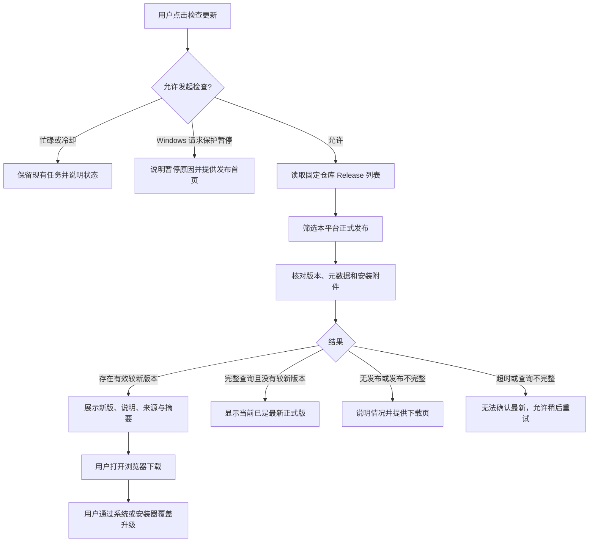

# OUNet 双端联系作者、开源入口与 GitHub 更新发布规划

日期：2026-10-23（Asia/Shanghai）  
状态：本规划已进入实施；双端功能、构建与发布工具的完成情况见[实施验证](RELEASE_UPDATE_VERIFICATION.md)。下文保留设计基线，不能当作全部验收已完成。  
源码基线：`e3fc48e`；Android `1.3.4 / versionCode 8`；Windows `0.3.0 测试版`。  
建议目标：Android `1.3.5 / versionCode 9`、Windows `0.3.1`；实施开始时再次核对版本，避免与其他更新冲突。

## 1. 更新目标与交付边界

本次更新建立完整的“找到作者 → 查看源码 → 获取安装包 → 检查并完成升级”路径。保留两端已实现的手动更新机制，补齐产品入口、发布资产和可重复执行的发布流程。

| 用户要求 | Android 交付 | Windows 交付 | 完成判据 |
| --- | --- | --- | --- |
| 联系作者 | 设置页新增联系作者模块，显示邮箱、复制、唤起邮件应用 | 帮助与关于页新增同等入口 | 邮箱准确，离线可读可复制；发送由用户在邮件应用完成 |
| 显示开源地址 | 完整显示仓库地址，支持打开与复制 | 完整显示仓库地址，支持打开与复制 | 两端均指向 `https://github.com/JieShenAI/OUNet` |
| GitHub 下载软件 | 发布 Android 独立 Release 及安装附件 | 发布 Windows 独立 Release 及安装附件 | 未登录用户也能从公开 Release 下载可安装文件 |
| 从 GitHub 更新 | 检查本平台最新正式版，前往准确发布页下载 APK | 检查本平台最新正式版，浏览器下载对应安装器 | 旧版可发现新版，覆盖安装后本地数据保留 |

本期采用用户主动检查、浏览器下载、系统或安装器确认升级的路径。不开启启动时自动检查、周期更新任务、静默安装或应用内下载器。正式更新完成前不将“源码已上传”“本地已构建”描述为“用户已能在线更新”。

本期涉及 Android、Windows、发布脚本、GitHub Actions 和使用文档。CLI 不新增更新功能；认证策略、监测间隔、账号存储和各平台既有失败保护继续按当前实现运行。

## 2. 已核实的现状与实际缺口

### 2.1 仓库与本地产物

2026-10-23 通过已连接的 GitHub 工具读取 [Releases API](https://api.github.com/repos/JieShenAI/OUNet/releases?per_page=100)，返回 `[]`；该连接当前可见的 Release 集合为空。仓库为公开仓库，默认分支为 `main`。这是一份时点核查，实施前需要重新读取。

上一轮已用当前源码生成 Android 正式签名 APK、Windows 安装器和免安装目录，并完成本地自动检查。这些文件存在本机，尚不能替代公开发布与跨版本实机升级验收。

### 2.2 源码能力盘点

| 范围 | 当前证据 | 本期处理 |
| --- | --- | --- |
| Android 设置 | `MainActivity.java` 已有离线介绍、版权、检查更新和发布页按钮 | 增加直接可见的邮箱、源码和下载入口，整理为关于区域 |
| Android 更新 | `UpdateRepository.java` 已查询固定仓库，排除草稿、预发布和其他平台 | 完善结果状态、分页完整性、缺失附件检查和可测试性 |
| Android 协议 | `ReleaseMetadata.java` 严格约束包名、原证书指纹、标签、APK URL 和摘要格式 | 保持旧客户端可识别的字段与旧名 APK URL |
| Windows 帮助 | `desktop/qml/HelpPage.qml` 已有版本和手动检查更新 | 新增联系作者、源码和发布首页操作 |
| Windows 更新 | `update.py` 已校验本平台版本、安装 URL 与 SHA-256 格式 | 补分页、发布附件一致性与错误状态 |
| Windows 请求 | `controller.py` / `request_policy.py` 将更新请求纳入全局请求保护 | 保留门禁，清楚说明暂停原因；浏览器入口保持可用 |
| 本地发布准备 | 两端构建脚本已产出安装包、摘要与更新 JSON | 增加一致性检查、精确资产清单和发布回读 |
| GitHub 构建 | `android.yml` 可手动构建并上传 Actions artifact | 补正式 Release 流程；artifact 不能当作普通用户下载页 |
| Windows CI | `ci.yml` 运行桌面离线测试，没有安装器构建发布 | 增加 Windows 构建、独立运行检查与发布作业 |

邮箱 `shencv@163.com` 已出现在根目录 `SECURITY.md`，但两端应用缺少面向普通用户的联系模块。仓库地址虽已用于更新和部分版权文案，也缺少统一、清楚的开源入口。

### 2.3 必须保留的兼容条件

1. Android 包名继续使用 `cn.jieshen.oucautologin`，正式签名沿用原密钥；新的二进制必须高于所有已对外分发的同包名、生产签名包的最大 `versionCode`，包括预发布和已撤回版本。同一份已验证构建由预发布转为正式时可以保持版本和原字节。
2. 现有 Android 客户端严格要求 `android-vX.Y.Z`、`android-update.json` 和 `ouc-autologin-X.Y.Z-release.apk`。发布时同时提供品牌名 APK 和字节完全相同的旧名兼容 APK。
3. Windows 更新协议使用 `windows-vX.Y.Z`、`windows-update.json` 和 `OUNet-X.Y.Z-Setup-x64.exe`，版本按数字分段比较。
4. Windows 保持原 AppId、安装目录、用户数据目录、自启注册名称、单实例锁和 DPAPI 当前用户加密方式。
5. 两端目前都没有校验“浏览器最终下载到磁盘的安装包”。应用校验元数据，发布流水线校验实际文件；不能在界面中宣称应用已完成下载文件验签。

## 3. 页面与交互方案

### 3.1 Android 信息架构

沿用现有设置页，不新增底部导航。整理为下列区域，保留现有设置和离线文档：

```text
设置
├─ 现有网络、通知和后台设置
├─ 使用说明：APP 介绍 / 数据使用 / 版权与第三方声明
└─ 关于 OUNet
   ├─ OUNet / 校园网络助手 / 当前版本
   ├─ 联系作者：shencv@163.com
   │  └─ 发送邮件 / 复制邮箱
   ├─ 开源地址：https://github.com/JieShenAI/OUNet
   │  └─ 打开项目 / 复制地址
   └─ 获取与更新：检查更新 / GitHub 下载页
```

完整地址允许换行，避免只用没有文字的图标。邮箱和仓库均采用可复制内容；小屏、大字体下按钮可分行。触控目标采用 Android 可访问性尺寸，按钮提供清楚名称。

### 3.2 Windows 信息架构

在现有“帮助与关于”页增加卡片，保留四个主页面：

```text
帮助与关于
├─ 应用信息：OUNet / Windows 当前版本 / 独立开发说明
├─ 遇到问题：诊断、导出、本机数据目录
├─ 联系作者：完整邮箱 / 发送邮件 / 复制邮箱
├─ 开源项目：完整仓库地址 / 打开项目 / 复制地址
└─ 获取与更新：当前版本 / 检查 Windows 更新 / GitHub 下载页
```

使用现有 `Panel`、`AppText`、`AppButton`、`CopyText` 和主题 token。完整 URL 可换行；保持键盘焦点顺序、深浅色对比和高 DPI 可读性。新增按钮设置稳定的 `objectName`，供既有 QML 交互检查使用。

### 3.3 联系作者行为

| 项目 | 约定 |
| --- | --- |
| 邮箱 | `shencv@163.com`，随应用离线提供 |
| Android 调用 | `ACTION_SENDTO` + `mailto:`；避免使用能把邮件投向普通分享应用的泛化 Intent |
| Windows 调用 | 后端通过 `QDesktopServices.openUrl()` 打开固定 `mailto:`；检查返回值并显示结果 |
| 默认主题 | `OUNet 反馈 - Android <版本>` 或 `OUNet 反馈 - Windows <版本>`；正确进行 URI 编码 |
| 默认正文 | 可提供问题描述、复现步骤的空模板；不自动填充账号、密码、设备标识或日志 |
| 无邮件应用 | 提示“未能打开邮件应用，可复制邮箱后联系作者”；复制操作仍然可用 |
| 成功反馈 | 打开成功只表示已交给系统处理，不显示“邮件已发送” |

用户点击“发送邮件”只打开邮件编辑器，应用不直接发送邮件。诊断导出仍由原入口完成，不自动附加到邮件。

### 3.4 项目与下载入口

固定展示和打开以下地址：

- 项目源码：`https://github.com/JieShenAI/OUNet`
- 软件发布：`https://github.com/JieShenAI/OUNet/releases`
- 作者邮箱：`shencv@163.com`

打开浏览器失败时显示原因并提供复制地址。打开源码和发布首页不先发版本检查请求；断网、Windows 请求暂停或没有正式发布时，用户仍可查看和复制这些地址。

每个平台增加简单的编译期项目信息入口，例如 Android `ProjectLinks.java`、Windows `project_info.py`。集中定义邮箱、仓库和发布首页，更新模块复用相同仓库来源；本期无需远程配置服务或新的公共运行时库。

## 4. 更新体验与状态模型

### 4.1 用户操作链路



Android 新版按钮继续打开已经校验的对应 Release 页面，用户从 Assets 选择 APK；Windows 可继续打开已经校验的安装器 URL，同时提供对应 Release 页面。下载文件均来自本仓库 GitHub Release。

### 4.2 结果与按钮约定

| 状态 | 建议显示 | 可执行操作 |
| --- | --- | --- |
| 尚未检查 | 当前版本；点击检查本平台正式版 | 检查、发布首页 |
| 检查中 | 正在检查 GitHub 发布… | 不重复派发；发布首页可用 |
| 检查冷却 | 请在倒计时结束后重试 | 保留上次结果并标明时间 |
| 有新版本 | 新版版本号、发布日期、更新摘要、来源与 SHA-256 | 前往新版下载、发布说明 |
| 已最新 | 当前已是最新正式版；显示检查时间 | 发布首页 |
| 未有正式发布 | 尚无可供本平台更新的正式发布 | 发布首页；可查看预览版说明 |
| 当前本地版更高 | 当前版本高于发布源正式版 | 发布首页；不提示降级 |
| 发布不完整 | 该版本发布文件不完整，暂不可更新 | 发布首页；不展示有效下载主按钮 |
| 查询范围未读完 | 尚无法确认最新版本 | 稍后重试、发布首页 |
| GitHub 限流 | 请求暂受 GitHub 限制，显示可用的重试时间 | 到时重试、发布首页 |
| 无网络、超时、无效响应 | 暂时无法检查更新 | 重试、发布首页 |
| 系统不兼容 | 新版要求更高系统版本 | 查看发布说明；不提供可安装承诺 |
| Windows 请求保护暂停 | 自动网络请求已暂停，本次未检查更新 | 原有手动恢复入口、发布首页 |

读取失败不能显示“已经最新”。上次检查结果可以留在内存中，但必须标明时间和本次失败，不能当作本次成功。下载按钮只能关联当前仍有效的校验结果；新检查失败后不继续展示未经说明的旧下载按钮。

Android 现有 60 秒检查节流继续保留，并明确冷却提示。Windows 增加同等的手动检查合并与冷却，不进入监测周期。GitHub 官方对匿名公共 REST 请求设有限额，校园共享出口可能共同消耗限额，因此不在客户端内置 GitHub Token；错误提示依据响应中的限流信息，不用固定倒计时冒充服务端恢复时间。[官方速率限制说明](https://docs.github.com/en/rest/using-the-rest-api/rate-limits-for-the-rest-api)

## 5. 更新查询与发布协议

### 5.1 平台隔离与版本选择

| 平台 | 发布标签 | 默认更新渠道 | 版本比较 |
| --- | --- | --- | --- |
| Android | `android-vX.Y.Z` | `draft=false` 且 `prerelease=false` | 经校验的 `versionCode`，更高才提示更新 |
| Windows x64 | `windows-vX.Y.Z` | `draft=false` 且 `prerelease=false` | 三段整数元组，不能按字符串排序 |

两平台独立选择自己的最新版本。GitHub 的 `/releases/latest` 和 `/releases/latest/download/<asset>` 属于仓库级入口，不能同时表示“最新 Android”和“最新 Windows”；应用不以该入口定位本平台安装包。README 的下载入口链接发布首页，并明确两个平台文件名。[GitHub Release 链接规则](https://docs.github.com/en/repositories/releasing-projects-on-github/linking-to-releases)

当前 Windows `0.3.0` 仍是测试版，本期不直接把旧安装器改名成正式版。建议 `0.3.1` 完成本文覆盖安装与运行验收后进入默认正式渠道；未达到正式发布门槛时标记 GitHub prerelease，并在下载页清楚标注。现有客户端会跳过 prerelease，这是已知渠道行为；“检查最新版本”默认指最新正式版，预览版自动更新不在本期范围。

### 5.2 完整性与异常处理算法

1. 只访问固定仓库的 Release 列表，使用 GitHub 分页参数；不依据列表首项或发布时间直接判定最新版本。
2. 按标签、draft、prerelease 和平台规则筛选；按数值比较候选版本。
3. 对候选元数据校验字段、标签、平台、包名或架构、版本、下载 URL 和 SHA-256 格式；对照该 Release 的附件清单，确认元数据与实际安装附件同时存在。
4. Android 确认主包及旧名兼容包；Windows 确认同版本 x64 Setup。必要时单独读取附件清单并处理附件分页，不能把列表响应里的部分附件当作完整清单。
5. 采用有边界的分页策略：建议每页 30 条、最多 10 页、全程 20 秒预算，实施时按测试结果调整；每次请求与重定向均受总预算、体积限制和来源校验约束。预算上限保证 UI 不会长期挂起，不保证所有历史发布都能读取。
6. 只有读取到列表结尾并完成相关候选校验后，才能显示“已最新”或“尚无正式版”。达到页数、候选或时间上限时显示“无法确认最新”。
7. 已找到可验证且高于本地的版本、但列表尚未读完时，可显示“发现可更新版本，尚未确认是否最新”；产品默认优先完成查询再开放主要下载操作。
8. 更高版本的正式 Release 缺元数据、缺安装附件或字段冲突时，报告“发布不完整”，不静默退回旧版并声称已最新。已有较低版本下载可在发布首页由用户自行查看。
9. 无效 JSON、HTML 认证页、重复关键字段或关键附件重名、错误来源和异常跳转均不得产生有效更新结果；正常无发布与协议错误分别呈现。

当前 Windows 只取前 30 条发布；Android 最多扫描 60 条、5 个 Android 候选。新客户端补齐上述边界处理。旧客户端的限制无法远程改变，首次上线应保持最新两端 Release 在旧客户端可扫描范围内，并实际用旧客户端检查；长期若触及旧版边界，在发布首页提供手动升级说明。

### 5.3 Android 元数据契约

保留 `android-update.json` 的现有字段语义：

| 字段 | 规划约束 |
| --- | --- |
| `applicationId` | 固定 `cn.jieshen.oucautologin` |
| `versionCode` | 构建 APK 实际版本号；建议本次为 `9`；新二进制高于所有已对外分发生产包的最大编号 |
| `versionName` | 与标签及 APK 内版本一致；建议 `1.3.5` |
| `minSdk` | 从实际 APK 读取并校验，当前仍为 `28` |
| `releaseUrl` | `https://github.com/JieShenAI/OUNet/releases/tag/android-v1.3.5` |
| `apkUrl` | 保持旧协议：`https://github.com/JieShenAI/OUNet/releases/download/android-v1.3.5/ouc-autologin-1.3.5-release.apk` |
| `sha256` | 本次实际 APK 的 64 位十六进制 SHA-256 |
| `signingCertSha256` | 保持 `ReleaseMetadata.CERT` 所固定的原正式证书指纹；构建时以 apksigner 核验 |
| `releaseNotes` | 当前版本实际发布说明；不沿用旧版本说明 |

新旧名称 APK 必须字节相同，摘要一致。任何后续契约扩展只增加可选字段；若需要改字段含义或下载命名，必须先设计兼容迁移。本期不改动旧客户端下载地址规则。

### 5.4 Windows 元数据契约

| 字段 | 规划约束 |
| --- | --- |
| `platform` | 固定 `windows-x64` |
| `version` | 与 Python 版本、EXE 文件版本、安装器版本、标签一致；建议 `0.3.1` |
| `url` | `https://github.com/JieShenAI/OUNet/releases/download/windows-v0.3.1/OUNet-0.3.1-Setup-x64.exe` |
| `sha256` | 本次实际 Setup 文件的 SHA-256 |
| `notes` | 当前 Windows 版本发布摘要 |

保留 JSON 现有读取方式、UTF-8 编码和字段类型。Windows 最低系统仍为 Windows 10 1809+、x64；本期不增加 ARM64 或 x86 更新分流。

### 5.5 网络、线程与本地保护

Android 更新继续在独立工作线程执行，通过已有 UI 生命周期刷新结果，旋转或关闭对话框不重复派发网络请求。仓库查询不触发校园认证，也不附带账号、密码、Cookie 或认证上下文。

Windows 继续通过现有控制器执行器和 `RequestClient` 查询。全局实际 HTTP 三连败暂停仍适用于更新；GitHub 请求不计入 XHA 调用次数，但按当前全局网络门禁结算。不能为实现更新另开一个绕过保护的网络客户端。打开邮件或外部浏览器由操作系统接管，不更改 OUNet 的暂停状态。

两端延续 HTTPS、固定仓库和必要 CDN 白名单、有限重定向、超时和响应大小限制。Windows 继续使用 API asset 入口读取更新 JSON；处理 CDN 跳转时重新校验目标。SHA-256 仅表示已发布文件的摘要，Windows 未代码签名时明确说明，不能把摘要等同于发布者签名。

## 6. 版本、构建与资产清单

### 6.1 版本管理

| 范围 | 当前 | 建议目标 | 实施要点 |
| --- | --- | --- | --- |
| Android | `1.3.4 / 8` | `1.3.5 / 9` | APK、Gradle、标签、JSON、发布说明一致 |
| Windows | `0.3.0 测试版` | `0.3.1` | `__init__.py`、`version_info.txt`、`.iss` 及更新 JSON 一致 |
| 项目总版本 | 无统一版本要求 | 继续平台独立 | 不要求手机和桌面使用同一版本号 |

Windows 优先由 `ouc_desktop.__version__` 派生 EXE 和安装器版本，或在构建前加严格一致性检查；避免本期为版本管理引入额外服务。新修复二进制高于已对外分发的正式、预览和撤回版本，不复用已分发编号。Android 发布说明路径按构建版本解析，替换当前脚本中固定的 `ANDROID_V1_3_4_RELEASE_NOTES.md`；Windows `prepare_release.py` 的硬编码摘要也改为从对应版本说明生成。

### 6.2 Android Release

建议标题：`OUNet Android 1.3.5`；标签：`android-v1.3.5`。

| 附件 | 必需 | 用途 |
| --- | --- | --- |
| `OUNet-1.3.5-release.apk` | 是 | 用户直接下载的品牌主包 |
| `OUNet-1.3.5-release.apk.sha256` | 是 | 主包摘要 |
| `ouc-autologin-1.3.5-release.apk` | 是 | 旧客户端兼容入口，与主包字节相同 |
| `ouc-autologin-1.3.5-release.apk.sha256` | 是 | 兼容包摘要 |
| `android-update.json` | 是 | 应用内检查更新 |
| `ANDROID_RELEASE_NOTES.md` | 是 | 版本说明与安装指引，也写入 Release 正文 |

Release 正文先说明 Android、Android 9+、下载哪个 APK，以及已有正式版可以覆盖安装。说明品牌包和兼容包内容相同，不引导用户安装两次；GitHub 自动提供的源码压缩包不是 APK。

### 6.3 Windows Release

建议标题：`OUNet Windows 0.3.1`；标签：`windows-v0.3.1`。

| 附件 | 必需 | 用途 |
| --- | --- | --- |
| `OUNet-0.3.1-Setup-x64.exe` | 是 | 默认推荐的安装与覆盖升级入口 |
| `OUNet-0.3.1-Setup-x64.exe.sha256` | 是 | 安装器摘要 |
| `windows-update.json` | 是 | 应用内检查更新 |
| `WINDOWS_RELEASE_NOTES.md` | 是 | 使用、升级、兼容与未签名说明 |
| `OUNet-0.3.1-Windows-x64-portable.zip` | 本期建议交付 | 完整 `OUNet/` 目录及其依赖，无需 Python |
| `OUNet-0.3.1-Windows-x64-portable.zip.sha256` | 提供 ZIP 时必需 | 免安装包摘要 |

当前 Windows 构建只生成免安装目录，ZIP 打包和摘要需新增。免安装包须保留目录结构、Qt 依赖和许可证，不能只上传 `OUNet.exe`。更新 JSON 仍默认指向安装器，免安装用户在 Release 正文查看替换目录指引。

### 6.4 发布资产隔离

禁止直接将整个长期使用的 `android/dist/*` 或 `desktop/dist/*` 上传到 Release。这些目录含历史版本，可能把旧版本、其他平台或不相干文件一并发布。

每次构建使用独立的暂存目录和精确白名单；构建清单记录平台、版本、源码完整 SHA、文件名、大小、摘要、Android 证书指纹和检查结果。公开文件不得包含本机绝对路径、账号、签名口令、密钥或原始校园响应。

## 7. GitHub Releases 发布架构

### 7.1 发布对象与流水线

两个平台各建一个 Release，独立构建、验证和发布。一个平台失败时，不把另一个平台已经完成的发布描述为双端全部成功。两份 Release 之间不承诺跨对象的原子事务。

建议增加 `.github/workflows/release.yml`，采用 `workflow_dispatch`：输入平台、目标版本、已确认的源码 ref，以及是否仅生成草稿。默认先产出构建与发布草稿；允许维护者在检查完整结果后发布。自动代码推送只运行测试，不直接形成正式更新。

| 作业 | 环境与职责 | 权限 |
| --- | --- | --- |
| 预检 | 验证版本、ref、标签、平台、发布说明与既有版本关系 | `contents: read` |
| Android 构建 | JDK、SDK、依赖；测试、Lint、原密钥签名、apksigner、摘要与 JSON | `contents: read`；只在受信任发布作业使用签名 secrets |
| Windows 构建 | Windows runner、固定 Python/依赖/Inno Setup；测试、素材、许可、PyInstaller、独立运行、Setup、ZIP | `contents: read` |
| 草稿准备 | 创建精确平台标签或验证已有同名标签，建立草稿并上传白名单资产 | 仅此作业及发布步骤使用 `contents: write` |
| 发布核验 | 验证附件、版本、摘要和来源；生成可审阅核验结果 | 发布前使用能读草稿的授权上下文 |
| 公开发布与回读 | 发布后匿名查询、下载核对、客户端验证 | 发布写权限与公开只读验证分开 |

对同一平台和版本设置并发锁，阻止同时发布。已存在同名标签时必须验证它指向同一源码提交；不移动旧标签，也不把新字节覆盖到已发布版本。

保留现有 Android 调试构建入口。正式发布优先复用两端已有构建和元数据脚本；将路径参数化并移除固定旧版说明，避免 CI 与本机生成两套协议。

### 7.2 发布前置条件

1. 目标代码合入 `main`，对应 CI 通过，发布引用锁定完整 commit SHA。
2. 新二进制的版本高于所有已对外分发版本；目标标签、Release 与本次提交对应。同一份既有预发布构建提升正式时核对原摘要，不重新打出同版本不同字节的包。
3. Android 原密钥可用，签名与既有正式版一致。GitHub Actions 已有四个 signing secrets 的读取设计，但远程 secrets 是否配置本轮未核实；未配置时以已有本机正式密钥构建，再走同样的资产验证与发布流程，不能生成替代密钥。
4. Windows Inno Setup 和依赖版本固定；构建环境不依赖开发机 PATH。CI 中的独立运行检查应保证 QML、DPAPI、TLS 和关键 DLL 可用；截图环境差异单独记录。
5. 发布前可执行的本地构建、独立运行和旧版覆盖安装检查已通过。匿名下载、旧客户端线上发现和公开后 R10 在 Publish 后执行，不作为首次 Publish 的循环前置条件。构建、发布凭据的配置只进入受信任上下文，不交给来自 fork 的代码执行。

Android 正式发布模式还需修改当前 `build.ps1` 的首次自动生成密钥分支：缺少既有签名材料时立即失败，密钥初始化应成为单独显式工具，避免误用新密钥产生无法覆盖升级的正式包。

### 7.3 每个平台的发布步骤

1. 冻结源码、版本和发布说明，生成独立暂存目录。
2. 执行完整构建，运行对应自动检查和升级验收。
3. 直接从最终安装文件读取版本、平台等信息；计算摘要，生成 JSON、校验文件和构建清单。
4. 校验 Android 主包与兼容包完全相同；验证安装包、元数据、标签和文件名相互匹配。
5. 创建 Draft Release，上传该次构建的白名单资产，正文列出平台、系统要求、安装步骤、变更、邮箱、源码和已知限制。
6. 使用有权限的接口读取草稿，核对附件数量、文件名、大小和内容摘要；草稿阶段不要求匿名访问成功。
7. 全部通过后 Publish；若启用了 GitHub 不可变发布，必须在发布前上传齐全部安装附件和元数据。
8. 发布后重新以未登录用户身份读取 API、打开浏览器下载链接并下载核对摘要，再用当前旧版和目标新版验证检查更新行为。
9. 更新 README、平台指南和验证记录，保存源码 SHA、Release URL、资产摘要和实际验收结果。

GitHub 官方提供草稿、发布及附件管理能力；本方案将完整附件先放草稿，公开发布作为单个平台的切换点。草稿隐藏和发布后是否允许改附件，还受仓库不可变发布设置影响，本轮未核实该设置。[Release 管理说明](https://docs.github.com/en/repositories/releasing-projects-on-github/managing-releases-in-a-repository)、[Release REST API](https://docs.github.com/en/rest/releases/releases)

### 7.4 发布失败与撤回

| 情况 | 处理 |
| --- | --- |
| 构建、签名或测试失败 | 停止该平台发布，保留日志；不能发布无效元数据 |
| 附件上传中断 | 保持草稿；只恢复同一次构建、摘要一致的文件 |
| 草稿附件混入旧文件 | 发布前移除并重验；不让不完整 Release 进入正式渠道 |
| 公开回读失败 | 短暂网络失败可重试；缺文件、摘要冲突或协议错误时立即改为 prerelease 撤出默认渠道，再修复和重验；不宣称用户更新已可用 |
| 公开后发现严重问题 | 将该 Release 改为 prerelease，使现有两端默认查询排除，并在说明中标注撤回 |
| 已有用户安装了问题版本 | 发布更高版本修复，Android 继续增加 versionCode；不以降级作为一般恢复方案 |

仅取消 GitHub Latest 标记不能撤回更新，因为两端按平台与数字版本选择。撤回不保证清除客户端已经显示的旧结果，需要告知用户重新检查；如已下载，应通过发布说明和更高修复版处理。发布后不复用旧版本号替换二进制；启用不可变发布时更不能依赖替换附件。

## 8. 实施工作包与文件映射

| 工作包 | 预计修改位置 | 具体结果 |
| --- | --- | --- |
| A1 Android 项目信息 | 新增 `ProjectLinks.java`、`res/values/strings.xml` 中相关资源 | 固定邮箱、仓库、发布首页及中文文案 |
| A2 Android UI | `MainActivity.java` | 关于区域、联系弹窗、复制和系统邮件操作、下载入口、状态提示 |
| A3 Android 更新可靠性 | `UpdateRepository.java`、`ReleaseMetadata.java` | 分页完整性、附件核对、结果类型、可注入传输与时钟 |
| A4 Android 发布准备 | `android/build.ps1`、`release_metadata.py`、`app/build.gradle` | 版本递增、动态发布说明、最终 APK 信息与签名交叉检查 |
| W1 Windows 项目信息 | 新增 `desktop/ouc_desktop/project_info.py` | 固定邮箱和链接来源 |
| W2 Windows UI | `HelpPage.qml`、`Main.qml`、`controller.py` | 联系、复制、外部链接、更新抽屉状态和门禁提示 |
| W3 Windows 更新可靠性 | `update.py`、`controller.py`、现有请求策略接口 | 分页、结果类型、附件核对、检查合并，保留统一执行器与门禁 |
| W4 Windows 版本与打包 | `__init__.py`、`version_info.txt`、`.iss`、`build.ps1`、`prepare_release.py` | 一致版本、Setup、完整 portable ZIP、摘要和发布说明；安装器补充发布者、支持和更新链接 |
| R1 发布流程 | `.github/workflows/android.yml`、新增 `release.yml`、按需新增发布校验脚本 | 双平台独立草稿、精确资产、发布回读和并发保护 |
| T1 自动与升级验证 | Android 既有测试；`desktop/tests`、`tools/test_ui.py`、`test_runtime.ps1`、升级测试工具 | 有意义的行为回归和发布协议检查 |
| D1 文档 | `README.md`、`docs/README.md`、`ANDROID.md`、`WINDOWS.md`、两端 README 与发布说明 | 公开下载、联系与升级步骤清楚且与实际状态一致 |

以上为建议文件拆分，可在实施时按现有代码组织微调。不要为三个链接建立复杂插件系统；新增架构主要服务于明确的更新状态、可靠校验和可重复测试。

## 9. 验收矩阵

### 9.1 联系作者与开源入口

| 编号 | 场景 | 通过条件 |
| --- | --- | --- |
| C01 | 两端进入关于区域 | 完整邮箱、完整源码地址、当前版本可见 |
| C02 | 离线复制邮箱、源码地址 | 剪贴板内容逐字准确，并有复制反馈 |
| C03 | 有默认邮件应用 | 正确收件人、编码后的主题；没有附带真实账号与日志 |
| C04 | 无邮件应用或系统调用失败 | 显示失败并保留复制路径，不崩溃，不声称已发送 |
| C05 | 打开源码或发布页 | 精确打开固定 GitHub URL；失败时可复制 |
| C06 | Android 大字体；Windows 150%/200% DPI、深浅色 | 地址不截断关键部分，按钮可达，键盘焦点与阅读顺序正常 |
| C07 | Windows 全局暂停或正在认证 | 联系和链接复制可用；版本查询按原门禁执行 |

### 9.2 更新协议与失败行为

| 编号 | 场景 | 通过条件 |
| --- | --- | --- |
| U01 | 同时存在 Android 和 Windows 发布 | 每端只识别自己平台 |
| U02 | 较新、相同、较旧版本 | 分别显示可更新、已最新、本地版本高于发布源；不降级 |
| U03 | `0.3.9 → 0.3.10`、Android code `9 → 10` | 数字比较正确 |
| U04 | 草稿、预发布、调试标签、其他架构或错误包名 | 不作为本平台正式更新 |
| U05 | 缺 JSON、缺 APK/Setup、错摘要格式、版本或标签冲突、重复关键附件 | 显示发布不完整，无有效升级按钮 |
| U06 | 假域名、HTTP、带用户信息 URL、异常端口、越界跳转 | 拒绝并提供发布首页 |
| U07 | GitHub 403/429、超时、无网、HTML 或无效 JSON | 不误报已最新；显示准确错误分类或安全通用提示 |
| U08 | 混排超过 30/60 条或超过 5 个 Android 候选 | 新实现按分页读取；超预算时承认未确认最新 |
| U09 | 连续点击检查、关闭再打开、Android 旋转 | 合并检查，不重复联网；冷却状态可理解 |
| U10 | 新版 Android minSdk 高于当前手机 | 说明不兼容，不引导为可直接安装 |
| U11 | Windows 全局暂停 | 检查不派发，不绕过保护；发布首页操作仍可用 |
| U12 | 检查更新及打开链接 | 不触发校园认证；XHA 请求次数不因 GitHub 查询增加 |
| U13 | 发布撤回为 prerelease 后重新检查 | 不再把撤回版本作为正式更新；不复用失效结果 |
| U14 | 只有另一个平台或只有预览版 | 如实显示暂无本平台正式版，不把仓库 Latest 当作本端最新版 |

协议测试使用固定模拟响应，不在每次单元测试中访问 GitHub。版本查询应允许注入传输、时钟或 Release 数据，重点验证状态和安全边界，避免测试只重复实现细节。

### 9.3 构建、发布与覆盖升级

| 编号 | 场景 | 通过条件 |
| --- | --- | --- |
| R01 | APK 构建 | 既有单元测试、Lint 通过；原签名校验通过；版本、SDK 与 JSON 一致 |
| R02 | Windows 构建 | 桌面与 CLI 测试、QML smoke/UI、独立 EXE 检查通过；无需开发 Python/Qt PATH |
| R03 | 安装附件 | 实际安装文件摘要与 `.sha256`、JSON、构建清单完全一致 |
| R04 | Android 兼容名 | 主包和旧名包内容完全相同；旧客户端所需文件全部发布 |
| R05 | GitHub 未登录访问 | Release 可见，平台文件可下载；下载后再次计算摘要一致 |
| R06 | 旧 Android `1.3.4` 检查并安装新版 | 能发现正式版、浏览器下载、系统覆盖安装成功，账号、设置和原记录保留 |
| R07 | 旧 Windows `0.3.0` 检查并安装新版 | 退出主窗口和托盘进程后覆盖成功，账号、设置、暂停状态和自启选择保留 |
| R08 | Windows portable ZIP | 解压后完整运行，无开发环境依赖，许可证随包；不要求只复制 EXE |
| R09 | 发布中断与恢复 | 保持草稿或说明失败，未向客户端提供半成品正式发布 |
| R10 | 两端公开发布后回读 | 当前旧版能发现目标新版；目标新版完整检查后显示已最新 |

Android 覆盖升级至少选择 Android 9 和一个较新系统进行验证；制造商后台保活沿用已有待验收记录，本期入口更新不宣称解决后台问题。Windows 至少验证 Windows 10 1809+ 与 Windows 11 x64 的运行与覆盖安装，无法获得的环境明确列为未验收。

Windows 现有 `test_install.ps1` 的同版本重装与标记文件检查不足以证明跨版本数据兼容，应增加旧版到新版的隔离升级案例，覆盖 DPAPI 账号、设置与请求暂停状态。验证不改动用户正在使用的真实安装或自启设置；使用独立测试环境和虚构账号。

## 10. 实施阶段、依赖与退出条件

以下为一名开发者的工作量估计，不是固定工期承诺；不含设备借用、GitHub 网络等待和签名材料恢复。

| 阶段 | 主要任务 | 依赖 | 退出条件 | 估计 |
| --- | --- | --- | --- | --- |
| P0 基线冻结 | 确认版本、原签名、渠道和公开资产契约 | 本规划 | 文件、版本和验收清单明确 | 0.5 人日 |
| P1 双端入口 | 关于卡片、邮箱、复制、源码与发布页 | P0 | 离线及系统调用场景可审阅 | 0.5–1 人日 |
| P2 更新完善 | 状态、分页、附件核对、门禁和行为测试 | P0 | 模拟协议与 UI 失败场景通过 | 1–1.5 人日 |
| P3 发布工程 | 版本校验、说明参数化、Windows ZIP、双端草稿与回读 | P0；可与 P1/P2 并行 | 可重复生成完整草稿及核验报告 | 1–1.5 人日 |
| P4 升级与公开发布 | 旧版实机升级、匿名下载验证、文档同步 | P1/P2/P3 | R01–R10 有证据，正式发布可供用户下载 | 0.5–1 人日 |

整体约 3.5–5.5 人日。正式公开发布以验收完成为准；Android 与 Windows 可分别达到发布条件，不互相阻塞已经可用的平台。

实施顺序建议先做双端入口与更新可靠性，再构建目标版本、验证旧版升级，最后创建并公开正式 Release。这样首个公开版本即包含本次功能，避免为同一版本先发布旧包再替换。

## 11. 交付清单与完成定义

本期实施完成后应具备：

1. Android 与 Windows 都能离线看到并复制邮箱、源码和发布地址，能调用系统邮件应用及浏览器。
2. 两端能检查本平台最新正式版，错误、暂停、预览版和不完整发布均有准确反馈。
3. GitHub 中存在各自独立且经过回读验证的 Release；安装包、摘要、元数据和说明来自同一次构建。
4. Android 旧版兼容附件保留；Windows 安装器与完整免安装包用途清楚。
5. 旧正式 Android 与当前 Windows 测试版到目标新版的覆盖升级有实际记录，未验证项单列。
6. README、平台文档、发布说明、构建与验证记录同步；不把设计目标写成已经通过的验收结果。

程序、构建与发布流程已按此规划实施，实际完成范围和待验收项见[实施验证](RELEASE_UPDATE_VERIFICATION.md)。

## 12. 依据与参考

- 项目源码与当前行为：[Android 开发说明](../android/README.md)、[Windows 开发说明](../desktop/README.md)、[安全与凭据](../SECURITY.md)、[贡献指南](../CONTRIBUTING.md)。
- 当前更新与安装说明：[Android 指南](ANDROID.md)、[Windows 指南](WINDOWS.md)。
- 仓库当前发布入口：[GitHub Releases](https://github.com/JieShenAI/OUNet/releases)；时点核查来源：[Releases API](https://api.github.com/repos/JieShenAI/OUNet/releases?per_page=100)。
- GitHub 官方：[Release REST API](https://docs.github.com/en/rest/releases/releases)、[链接到 Release](https://docs.github.com/en/repositories/releasing-projects-on-github/linking-to-releases)、[管理 Release](https://docs.github.com/en/repositories/releasing-projects-on-github/managing-releases-in-a-repository)、[REST 速率限制](https://docs.github.com/en/rest/using-the-rest-api/rate-limits-for-the-rest-api)。

远程状态与 GitHub 规则核查日期为 2026-10-23；实施前复核实际仓库状态。架构与工作量为本次方案建议，不代表已经部署的功能。
